# Thuyết minh tự động đa ngôn ngữ — Focused Use Cases (Actor: User)

**Version 1.0**

> Theo mẫu `FocusedUseCases.md` (Course Cast) và danh sách Use Case trong PRD (mục 6, Actor: User, UC05–UC18). Nhãn trường giữ tiếng Anh như mẫu, nội dung tiếng Việt. Use case Đăng nhập là **UC04** trong `FocusedusecasesGuest.md`; các UC ở đây tham chiếu tới nó bằng **{Login Authentication}**.

## Revision History

| Date     | Version | Description                                                          | Author     |
|----------|---------|----------------------------------------------------------------------|------------|
| 28-09-26 | 1.0     | Focused Use Cases, Use Case Diagram, Activity Diagrams (User, UC05–UC18) | Nhóm Đồ án |

## Ghi chú thiết kế (lệch/bổ sung so với PRD)

PRD chưa quy định các điểm sau, tài liệu này đề xuất để các UC nhất quán. Cần nhóm xác nhận và cập nhật PRD nếu chấp nhận.

| # | Đề xuất | Lý do | UC liên quan |
|---|---|---|---|
| 1 | Thêm trạng thái job `canceled` (PRD chỉ có pending / processing / done / failed) | UC17 Hủy job cần một trạng thái kết thúc riêng, không thể xem là `failed` | UC12, UC15, UC17 |
| 2 | Xóa job là xóa mềm: thêm trường `deletedAt` vào `TranscriptionJob`, xóa file trong storage nhưng giữ bản ghi | UC20 (Admin thống kê số job) sẽ sai nếu bản ghi bị xóa hẳn | UC16 |
| 3 | Thêm thực thể `JobReport` (jobId, userId, loại lỗi, mô tả, thời điểm) | UC18 cần nơi lưu báo lỗi; PRD chưa có bảng | UC18 |
| 4 | Giới hạn định dạng, dung lượng, thời lượng, số ngôn ngữ đích cấu hình theo vai trò (User < Premium) | PRD chỉ nói Premium có giới hạn cao hơn, chưa nêu con số | UC08, UC10, UC11 |
| 5 | Chưa có `JobReport` hoặc `deletedAt` trong ERD/Schema hiện tại | Hệ quả của đề xuất 2 và 3 | ERD (mục 9 PRD) |

Các Business Rule (BR-x.y) là đề xuất của nhóm, không lấy từ PRD; x là số thứ tự UC. Mật khẩu tham chiếu BR-3.2 trong `FocusedusecasesGuest.md`.

## Table of Contents

| Mã   | Use Case |
|------|----------|
| [UC05](#uc05--đăng-xuất) | Đăng xuất |
| [UC06](#uc06--cập-nhật-thông-tin-cá-nhân-profile) | Cập nhật thông tin cá nhân (Profile) |
| [UC07](#uc07--đổi-mật-khẩu) | Đổi mật khẩu |
| [UC08](#uc08--upload-videoaudio) | Upload video/audio |
| [UC09](#uc09--chọn-ngôn-ngữ-nguồn-source-language) | Chọn ngôn ngữ nguồn (source language) |
| [UC10](#uc10--chọn-một-hoặc-nhiều-ngôn-ngữ-đích-target-languages) | Chọn một hoặc nhiều ngôn ngữ đích (target languages) |
| [UC11](#uc11--gửi-yêu-cầu-xử-lý-thuyết-minh-submit-job) | Gửi yêu cầu xử lý thuyết minh (Submit Job) |
| [UC12](#uc12--theo-dõi-trạng-thái-xử-lý-job-real-timepolling) | Theo dõi trạng thái xử lý job (real-time/polling) |
| [UC13](#uc13--xempreview-kết-quả-thuyết-minh-audiovideo-output) | Xem/preview kết quả thuyết minh (audio/video output) |
| [UC14](#uc14--tải-xuống-file-kết-quả) | Tải xuống file kết quả |
| [UC15](#uc15--xem-lịch-sử-các-job-đã-xử-lý) | Xem lịch sử các job đã xử lý |
| [UC16](#uc16--xóa-job--xóa-file-khỏi-lịch-sử) | Xóa job / xóa file khỏi lịch sử |
| [UC17](#uc17--hủy-job-đang-xử-lý) | Hủy job đang xử lý |
| [UC18](#uc18--báo-lỗi-kết-quả-xử-lý-feedbackreport) | Báo lỗi kết quả xử lý (feedback/report) |

## Use Case Diagram tổng quan (User)

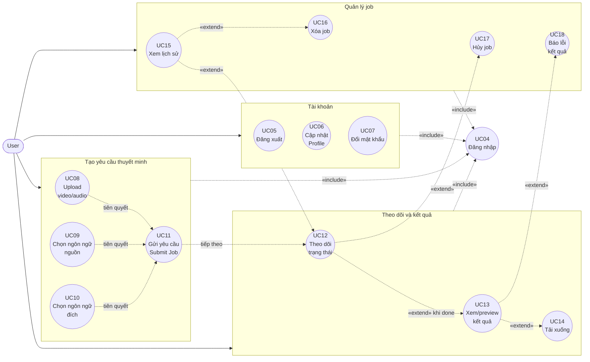

---

## UC05 — Đăng xuất

### Use Case Diagram

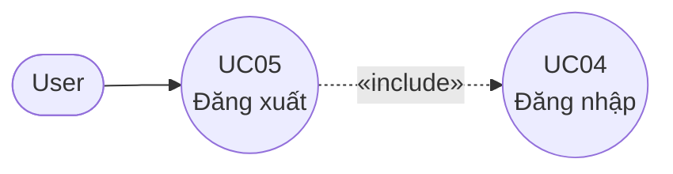

| Field | Content |
|---|---|
| **Use Case Number** | UC05 |
| **Use Case Name** | Đăng xuất |
| **Actor(s)** | *User* |
| **Maturity** | Focused |
| **Summary** | *User* kết thúc phiên làm việc (`UserSession`) trên thiết bị đang dùng và quay về trạng thái *Guest*. |

### Basic Course of Events

| Actor Action | System Response |
|---|---|
| 1. Perform **{Login Authentication}** | |
| | 2. Hệ thống hiển thị trang chủ người dùng với các chức năng. |
| 3. User chọn "Đăng xuất". | |
| | 4. Hệ thống yêu cầu xác nhận đăng xuất. |
| 5. User xác nhận đăng xuất. **A1** | |
| | 6. Hệ thống vô hiệu hóa `UserSession` hiện tại (thu hồi `token`). **E1, E2** |
| | 7. Hệ thống xóa dữ liệu phiên lưu trên thiết bị và chuyển về trang chủ với vai trò Guest. <br><br>*Use case kết thúc.* |

### Alternative Paths

**A1.** User chọn "Hủy" ở bước 5. Hệ thống giữ nguyên phiên làm việc và quay lại trang đang xem. Use case kết thúc.

### Exception Paths

**E1.** Nếu không thu hồi được phiên trên máy chủ (lỗi hệ thống hoặc mất kết nối), thiết bị vẫn xóa `token` cục bộ và chuyển về trang chủ Guest; phiên trên máy chủ sẽ hết hiệu lực theo `expiresAt`. Tiếp tục bước 7.

**E2.** Nếu phiên đã hết hạn hoặc không còn tồn tại, hệ thống coi như đăng xuất thành công. Tiếp tục bước 7.

### Other Fields

| Field | Content |
|---|---|
| **Extension Points** | None |
| **Triggers** | User muốn kết thúc phiên làm việc (ví dụ dùng chung thiết bị). |
| **Assumptions** | Mỗi thiết bị (`web`, `ios`, `android`) có một `UserSession` riêng. |
| **Preconditions** | User có phiên làm việc đang hoạt động. |
| **Post Conditions** | Phiên trên thiết bị hiện tại không còn hiệu lực; thiết bị quay về trạng thái Guest. |
| **Reference: Business Rules** | BR-5.1: Đăng xuất chỉ kết thúc phiên của thiết bị hiện tại. <br>BR-5.2: `token` đã thu hồi không được dùng lại. <br>BR-5.3: Các job đang xử lý vẫn tiếp tục chạy sau khi User đăng xuất. |
| **Author(s)** | Nhóm Đồ án |
| **Date** | 28-09-26 |

### Activity Diagram

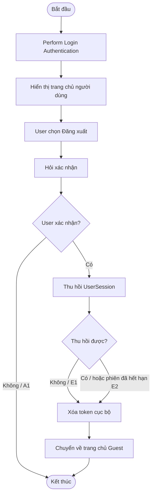

---

## UC06 — Cập nhật thông tin cá nhân (Profile)

### Use Case Diagram

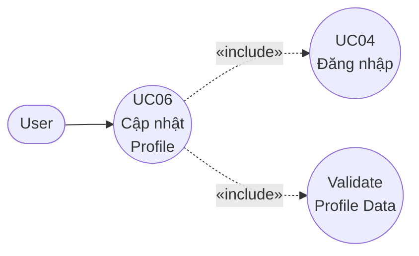

| Field | Content |
|---|---|
| **Use Case Number** | UC06 |
| **Use Case Name** | Cập nhật thông tin cá nhân (Profile) |
| **Actor(s)** | *User* |
| **Maturity** | Focused |
| **Summary** | *User* xem và chỉnh sửa thông tin cá nhân gồm họ tên, ảnh đại diện và ngôn ngữ giao diện mặc định. |

### Basic Course of Events

| Actor Action | System Response |
|---|---|
| 1. Perform **{Login Authentication}** | |
| | 2. Hệ thống hiển thị trang chủ người dùng với các chức năng. |
| 3. User chọn "Thông tin cá nhân". | |
| | 4. Hệ thống hiển thị thông tin hiện tại: họ tên (`fullName`), email (chỉ đọc), ảnh đại diện (`avatarUrl`), ngôn ngữ giao diện (`preferredLanguage`). |
| 5. User chỉnh sửa họ tên, ảnh đại diện và/hoặc ngôn ngữ giao diện. **A1** | |
| 6. User chọn "Lưu". **A2** | |
| | 7. Hệ thống kiểm tra dữ liệu. **{Validate Profile Data}** **E1, E2** |
| | 8. Hệ thống lưu thay đổi và cập nhật `updatedAt`. **E3** |
| | 9. Hệ thống thông báo cập nhật thành công và hiển thị thông tin mới. <br><br>*Use case kết thúc.* |

### Alternative Paths

**A1.** User đổi ảnh đại diện: chọn ảnh từ thư viện hoặc chụp mới (Mobile); hệ thống hiển thị bản xem trước. Quay lại bước 5.

**A2.** User chọn "Hủy". Hệ thống bỏ các thay đổi chưa lưu và hiển thị lại thông tin đã lưu. Quay lại bước 4.

### Exception Paths

**E1.** Tại **{Validate Profile Data}**, nếu họ tên bỏ trống hoặc vượt độ dài cho phép, hoặc ngôn ngữ giao diện không thuộc danh sách hỗ trợ, hệ thống đánh dấu trường lỗi. Quay lại bước 5.

**E2.** Tại **{Validate Profile Data}**, nếu ảnh đại diện sai định dạng hoặc quá dung lượng, hệ thống thông báo lỗi và giữ ảnh cũ. Quay lại bước 5.

**E3.** Nếu không lưu được (lỗi cơ sở dữ liệu hoặc storage), hệ thống thông báo lỗi, giữ nguyên thông tin cũ và cho User thử lại. Quay lại bước 5.

### Other Fields

| Field | Content |
|---|---|
| **Extension Points** | **{Validate Profile Data}** — Kiểm tra họ tên, ngôn ngữ giao diện và tệp ảnh đại diện. (Xem BR-6.2, BR-6.3, BR-6.4) **E1, E2** |
| **Triggers** | User muốn xem hoặc thay đổi thông tin cá nhân. |
| **Assumptions** | Ảnh đại diện được lưu trong File Storage, `avatarUrl` trỏ tới tệp đó. |
| **Preconditions** | User đã đăng nhập. |
| **Post Conditions** | Thông tin cá nhân mới được lưu; `updatedAt` được cập nhật. |
| **Reference: Business Rules** | BR-6.1: Email không thay đổi qua chức năng này. <br>BR-6.2: Họ tên gồm 1 đến 100 ký tự. <br>BR-6.3: Ảnh đại diện định dạng JPG, PNG hoặc WebP, tối đa 5 MB. <br>BR-6.4: `preferredLanguage` phải thuộc danh sách ngôn ngữ giao diện hệ thống cung cấp. |
| **Author(s)** | Nhóm Đồ án |
| **Date** | 28-09-26 |

### Activity Diagram

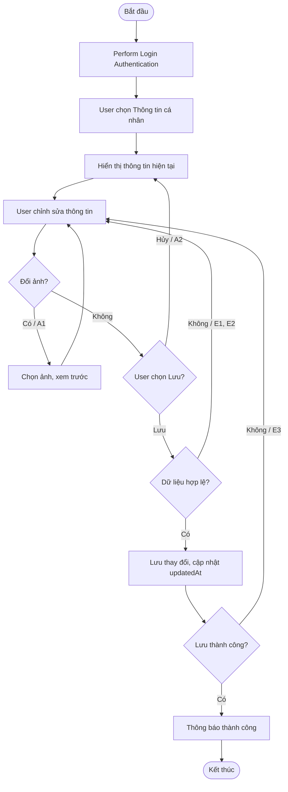

---

## UC07 — Đổi mật khẩu

### Use Case Diagram

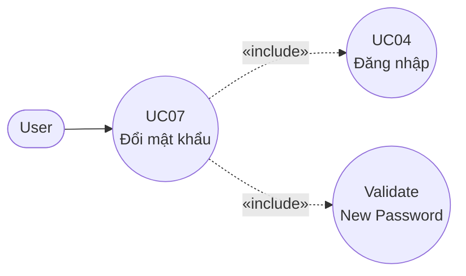

| Field | Content |
|---|---|
| **Use Case Number** | UC07 |
| **Use Case Name** | Đổi mật khẩu |
| **Actor(s)** | *User* |
| **Maturity** | Focused |
| **Summary** | *User* đổi mật khẩu đăng nhập bằng cách xác nhận mật khẩu hiện tại và đặt mật khẩu mới. |

### Basic Course of Events

| Actor Action | System Response |
|---|---|
| 1. Perform **{Login Authentication}** | |
| | 2. Hệ thống hiển thị trang chủ người dùng với các chức năng. |
| 3. User chọn "Đổi mật khẩu". | |
| | 4. Hệ thống hiển thị form gồm: mật khẩu hiện tại, mật khẩu mới, xác nhận mật khẩu mới. |
| 5. User nhập thông tin và chọn "Xác nhận". **A1** | |
| | 6. Hệ thống kiểm tra mật khẩu mới. **{Validate New Password}** **E1, E2, E3** |
| | 7. Hệ thống so khớp mật khẩu hiện tại với mật khẩu đã băm trong cơ sở dữ liệu. **E4** |
| | 8. Hệ thống băm mật khẩu mới, lưu vào cơ sở dữ liệu và cập nhật `updatedAt`. **E5** |
| | 9. Hệ thống hủy các `UserSession` khác của tài khoản (giữ phiên hiện tại). |
| | 10. Hệ thống thông báo đổi mật khẩu thành công. <br><br>*Use case kết thúc.* |

### Alternative Paths

**A1.** User chọn "Hủy". Hệ thống bỏ dữ liệu đã nhập và quay về trang trước. Use case kết thúc.

### Exception Paths

**E1.** Nếu có trường bỏ trống, hệ thống đánh dấu trường lỗi. Quay lại bước 4.

**E2.** Nếu mật khẩu mới không đạt yêu cầu (BR-3.2) hoặc xác nhận không khớp, hệ thống thông báo lỗi. Quay lại bước 4.

**E3.** Nếu mật khẩu mới trùng mật khẩu hiện tại, hệ thống yêu cầu chọn mật khẩu khác. Quay lại bước 4.

**E4.** Nếu mật khẩu hiện tại không đúng, hệ thống thông báo "Mật khẩu hiện tại không đúng". Quay lại bước 4.

**E5.** Nếu không lưu được mật khẩu mới (lỗi cơ sở dữ liệu), hệ thống thông báo lỗi và giữ nguyên mật khẩu cũ. Quay lại bước 4.

### Other Fields

| Field | Content |
|---|---|
| **Extension Points** | **{Validate New Password}** — Kiểm tra trường bắt buộc, độ mạnh mật khẩu, khớp xác nhận và khác mật khẩu hiện tại. (Xem BR-3.2, BR-7.2) **E1, E2, E3** |
| **Triggers** | User muốn thay đổi mật khẩu vì lý do bảo mật. |
| **Assumptions** | User nhớ mật khẩu hiện tại. |
| **Preconditions** | User đã đăng nhập. |
| **Post Conditions** | Mật khẩu mới được lưu dưới dạng băm; các phiên khác của tài khoản không còn hiệu lực. |
| **Reference: Business Rules** | BR-7.1: Phải xác nhận đúng mật khẩu hiện tại trước khi đổi. <br>BR-7.2: Mật khẩu mới khác mật khẩu hiện tại và đạt BR-3.2 (tối thiểu 8 ký tự, gồm chữ và số). <br>BR-7.3: Mật khẩu chỉ lưu dưới dạng băm. <br>BR-7.4: Sau khi đổi, mọi phiên khác của tài khoản bị hủy. |
| **Author(s)** | Nhóm Đồ án |
| **Date** | 28-09-26 |

### Activity Diagram

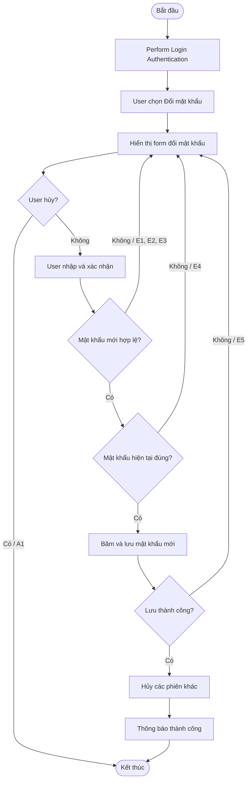

---

## UC08 — Upload video/audio

### Use Case Diagram

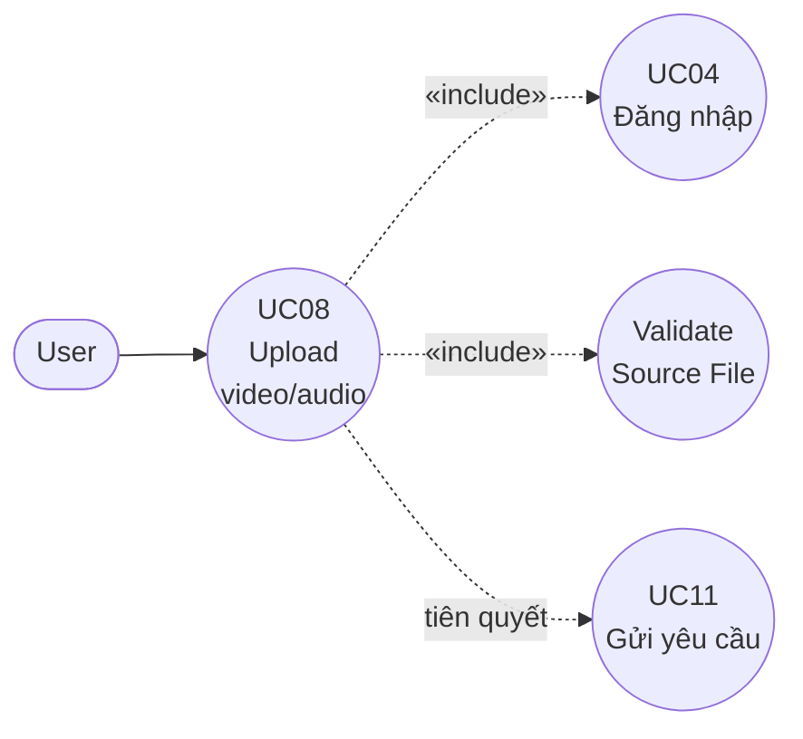

| Field | Content |
|---|---|
| **Use Case Number** | UC08 |
| **Use Case Name** | Upload video/audio |
| **Actor(s)** | *User* |
| **Maturity** | Focused |
| **Summary** | *User* tải một tệp video hoặc audio lên hệ thống để làm nguồn tạo thuyết minh. Tệp được lưu vào File Storage, chưa tạo job. |

### Basic Course of Events

| Actor Action | System Response |
|---|---|
| 1. Perform **{Login Authentication}** | |
| | 2. Hệ thống hiển thị trang chủ người dùng với các chức năng. |
| 3. User chọn "Tạo thuyết minh" (Upload). | |
| | 4. Hệ thống hiển thị màn hình upload (Web: kéo thả hoặc chọn tệp; Mobile: chọn từ thư viện hoặc tệp) cùng định dạng và dung lượng tối đa được hỗ trợ. |
| 5. User chọn một tệp video hoặc audio. | |
| | 6. Hệ thống kiểm tra tệp. **{Validate Source File}** **E1, E2, E4** |
| | 7. Hệ thống tải tệp lên File Storage và hiển thị tiến trình. **A2, E3** |
| | 8. Hệ thống lưu `sourceFileUrl` và hiển thị tên, loại, dung lượng, thời lượng của tệp; cho phép User chọn ngôn ngữ (UC09, UC10). **A1** <br><br>*Use case kết thúc.* |

### Alternative Paths

**A1.** User chọn "Đổi tệp". Hệ thống xóa tệp vừa tải lên khỏi storage. Quay lại bước 4.

**A2.** User chọn "Hủy" khi đang tải lên. Hệ thống dừng tải, xóa phần dữ liệu đã tải. Quay lại bước 4.

### Exception Paths

**E1.** Tại **{Validate Source File}**, nếu định dạng không được hỗ trợ, hệ thống thông báo và liệt kê định dạng hợp lệ. Quay lại bước 4.

**E2.** Tại **{Validate Source File}**, nếu tệp vượt dung lượng hoặc thời lượng cho phép theo vai trò của User, hệ thống thông báo giới hạn hiện tại. Quay lại bước 4.

**E3.** Nếu quá trình tải bị gián đoạn (mất kết nối, lỗi storage), hệ thống thông báo lỗi, xóa dữ liệu dở dang và cho User thử lại. Quay lại bước 4.

**E4.** Tại **{Validate Source File}**, nếu tệp hỏng hoặc không có luồng âm thanh, hệ thống từ chối tệp và thông báo lý do. Quay lại bước 4.

### Other Fields

| Field | Content |
|---|---|
| **Extension Points** | **{Validate Source File}** — Kiểm tra định dạng, dung lượng, thời lượng và sự tồn tại của luồng âm thanh. (Xem BR-8.1, BR-8.2, BR-8.3) **E1, E2, E4** |
| **Triggers** | User muốn tạo thuyết minh cho một video hoặc audio. |
| **Assumptions** | Thiết bị của User có kết nối mạng ổn định trong lúc tải. |
| **Preconditions** | User đã đăng nhập. |
| **Post Conditions** | Tệp nguồn được lưu trong File Storage và có `sourceFileUrl` sẵn sàng cho UC11; chưa có `TranscriptionJob` nào được tạo. |
| **Reference: Business Rules** | BR-8.1: Chấp nhận các định dạng video và audio thông dụng theo cấu hình hệ thống. <br>BR-8.2: Dung lượng và thời lượng tối đa theo vai trò (User thấp hơn Premium). <br>BR-8.3: Tệp phải chứa luồng âm thanh để Speech-to-Text xử lý được. <br>BR-8.4: Tệp chỉ truy cập được bởi chủ sở hữu. <br>BR-8.5: Tệp chưa được gửi thành job sau thời hạn cấu hình (đề xuất 24 giờ) sẽ bị dọn khỏi storage. |
| **Author(s)** | Nhóm Đồ án |
| **Date** | 28-09-26 |

### Activity Diagram

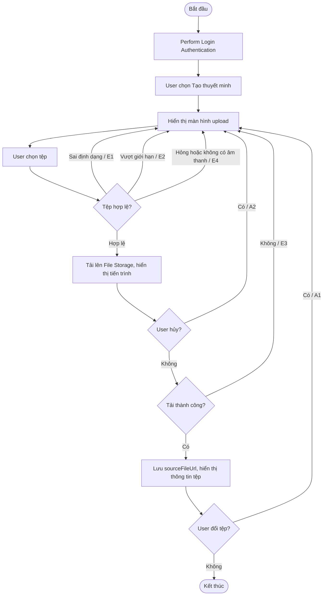

---

## UC09 — Chọn ngôn ngữ nguồn (source language)

### Use Case Diagram

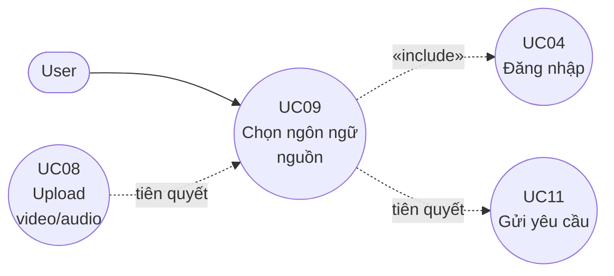

| Field | Content |
|---|---|
| **Use Case Number** | UC09 |
| **Use Case Name** | Chọn ngôn ngữ nguồn (source language) |
| **Actor(s)** | *User* |
| **Maturity** | Focused |
| **Summary** | *User* chỉ định ngôn ngữ được nói trong tệp đã upload để hệ thống thực hiện Speech-to-Text đúng ngôn ngữ. |

### Basic Course of Events

| Actor Action | System Response |
|---|---|
| 1. Perform **{Login Authentication}** | |
| | 2. Hệ thống hiển thị trang chủ người dùng với các chức năng. |
| 3. Use case bắt đầu khi User, sau khi đã upload tệp (UC08), chọn mục "Ngôn ngữ nguồn". | |
| | 4. Hệ thống tải danh sách *ngôn ngữ* đang được hỗ trợ (`isSupported = true`) và hiển thị. **E1, E2** |
| 5. User chọn một ngôn ngữ nguồn. **A1, A2** | |
| | 6. Hệ thống kiểm tra ngôn ngữ vẫn còn được hỗ trợ. **E3** |
| | 7. Hệ thống ghi nhận `sourceLanguage` vào yêu cầu đang soạn và hiển thị ngôn ngữ đã chọn. Nếu ngôn ngữ đích đã chọn trước đó (UC10) trùng ngôn ngữ nguồn mới, hệ thống bỏ chọn ngôn ngữ đích đó và thông báo cho User. <br><br>*Use case kết thúc.* |

### Alternative Paths

**A1.** User chọn ngôn ngữ nguồn khác sau khi đã chọn. Quay lại bước 5 của Basic Course of Events.

**A2.** User nhập từ khóa vào ô tìm kiếm để lọc danh sách ngôn ngữ. Hệ thống hiển thị các ngôn ngữ khớp. Quay lại bước 5.

### Exception Paths

**E1.** Nếu không tải được danh sách ngôn ngữ, hệ thống thông báo lỗi kèm nút "Thử lại". Quay lại bước 4.

**E2.** Nếu danh sách ngôn ngữ hỗ trợ rỗng, hệ thống thông báo hiện chưa có ngôn ngữ nào khả dụng và không cho tiếp tục tạo yêu cầu. Use case kết thúc.

**E3.** Nếu ngôn ngữ đã chọn vừa bị quản trị viên ngừng hỗ trợ, hệ thống thông báo và yêu cầu chọn lại. Quay lại bước 4.

### Other Fields

| Field | Content |
|---|---|
| **Extension Points** | None |
| **Triggers** | User đã upload tệp và cần chỉ định ngôn ngữ của nội dung gốc. |
| **Assumptions** | User biết ngôn ngữ được nói trong tệp. |
| **Preconditions** | User đã đăng nhập và đã upload tệp nguồn thành công (UC08). |
| **Post Conditions** | `sourceLanguage` được ghi nhận trong yêu cầu đang soạn (chưa tạo job). |
| **Reference: Business Rules** | BR-9.1: Chỉ hiển thị và cho chọn ngôn ngữ có `isSupported = true`. <br>BR-9.2: Mỗi yêu cầu có đúng một ngôn ngữ nguồn. <br>BR-9.3: Ngôn ngữ nguồn phải khác mọi ngôn ngữ đích trong cùng yêu cầu. |
| **Author(s)** | Nhóm Đồ án |
| **Date** | 28-09-26 |

### Activity Diagram

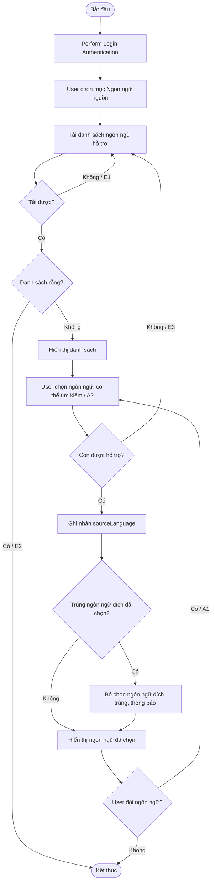

---

## UC10 — Chọn một hoặc nhiều ngôn ngữ đích (target languages)

### Use Case Diagram

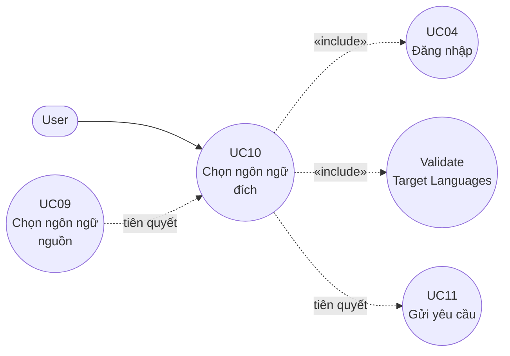

| Field | Content |
|---|---|
| **Use Case Number** | UC10 |
| **Use Case Name** | Chọn một hoặc nhiều ngôn ngữ đích (target languages) |
| **Actor(s)** | *User* |
| **Maturity** | Focused |
| **Summary** | *User* chọn một hoặc nhiều ngôn ngữ mà nội dung sẽ được dịch và thuyết minh sang. Mỗi ngôn ngữ đích cho ra một kết quả riêng. |

### Basic Course of Events

| Actor Action | System Response |
|---|---|
| 1. Perform **{Login Authentication}** | |
| | 2. Hệ thống hiển thị trang chủ người dùng với các chức năng. |
| 3. Use case bắt đầu khi User, sau khi đã chọn ngôn ngữ nguồn (UC09), chọn mục "Ngôn ngữ đích". | |
| | 4. Hệ thống tải danh sách *ngôn ngữ* đang được hỗ trợ, loại bỏ ngôn ngữ nguồn, và hiển thị cùng số ngôn ngữ đích tối đa User được chọn. **E4** |
| 5. User chọn một hoặc nhiều ngôn ngữ đích. **A1, A2** | |
| 6. User chọn "Xác nhận". | |
| | 7. Hệ thống kiểm tra lựa chọn. **{Validate Target Languages}** **E1, E2, E3** |
| | 8. Hệ thống ghi nhận danh sách `targetLanguages[]` vào yêu cầu đang soạn và hiển thị các ngôn ngữ đã chọn. <br><br>*Use case kết thúc.* |

### Alternative Paths

**A1.** User bỏ chọn một ngôn ngữ đã chọn. Hệ thống cập nhật danh sách chọn. Quay lại bước 5 của Basic Course of Events.

**A2.** User nhập từ khóa vào ô tìm kiếm để lọc danh sách ngôn ngữ. Quay lại bước 5.

### Exception Paths

**E1.** Tại **{Validate Target Languages}**, nếu User chưa chọn ngôn ngữ đích nào, hệ thống yêu cầu chọn ít nhất một. Quay lại bước 5.

**E2.** Tại **{Validate Target Languages}**, nếu số ngôn ngữ đích vượt mức tối đa theo vai trò, hệ thống thông báo giới hạn và gợi ý nâng cấp Premium (nếu có). Quay lại bước 5.

**E3.** Tại **{Validate Target Languages}**, nếu có ngôn ngữ đã chọn vừa bị ngừng hỗ trợ hoặc trùng ngôn ngữ nguồn, hệ thống loại ngôn ngữ đó khỏi lựa chọn và thông báo. Quay lại bước 5.

**E4.** Nếu không tải được danh sách ngôn ngữ, hệ thống thông báo lỗi kèm nút "Thử lại". Quay lại bước 4.

### Other Fields

| Field | Content |
|---|---|
| **Extension Points** | **{Validate Target Languages}** — Kiểm tra số lượng, tính hỗ trợ và khác ngôn ngữ nguồn. (Xem BR-10.1 đến BR-10.4) **E1, E2, E3** |
| **Triggers** | User đã chọn ngôn ngữ nguồn và cần chỉ định các ngôn ngữ muốn thuyết minh. |
| **Assumptions** | Ngôn ngữ nguồn đã được chọn. |
| **Preconditions** | User đã đăng nhập, đã upload tệp (UC08) và đã chọn ngôn ngữ nguồn (UC09). |
| **Post Conditions** | `targetLanguages[]` được ghi nhận trong yêu cầu đang soạn (chưa tạo job). |
| **Reference: Business Rules** | BR-10.1: Phải chọn ít nhất một ngôn ngữ đích. <br>BR-10.2: Số ngôn ngữ đích tối đa theo vai trò (Premium cao hơn User). <br>BR-10.3: Ngôn ngữ đích phải khác ngôn ngữ nguồn. <br>BR-10.4: Chỉ được chọn ngôn ngữ có `isSupported = true`. <br>BR-10.5: Mỗi ngôn ngữ đích sẽ tạo một bản ghi `JOB_TARGET_LANGUAGE` với `resultFileUrl` riêng khi gửi yêu cầu (UC11). |
| **Author(s)** | Nhóm Đồ án |
| **Date** | 28-09-26 |

### Activity Diagram

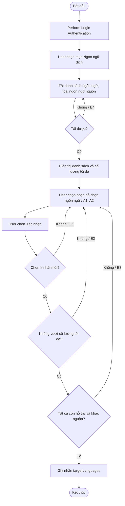

---

## UC11 — Gửi yêu cầu xử lý thuyết minh (Submit Job)

### Use Case Diagram

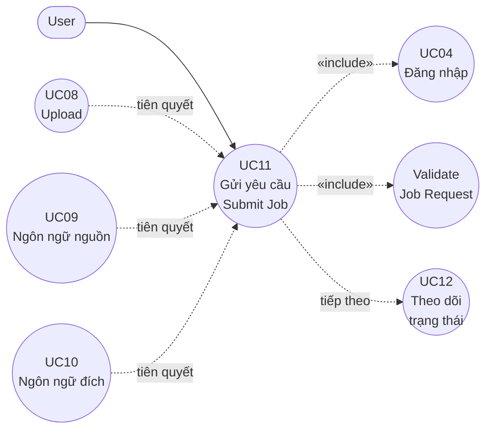

| Field | Content |
|---|---|
| **Use Case Number** | UC11 |
| **Use Case Name** | Gửi yêu cầu xử lý thuyết minh (Submit Job) |
| **Actor(s)** | *User* |
| **Maturity** | Focused |
| **Summary** | *User* xác nhận và gửi yêu cầu gồm tệp nguồn, ngôn ngữ nguồn và các ngôn ngữ đích. Hệ thống tạo `TranscriptionJob` và đưa vào hàng đợi để AI Pipeline xử lý nền. |

### Basic Course of Events

| Actor Action | System Response |
|---|---|
| 1. Perform **{Login Authentication}** | |
| | 2. Hệ thống hiển thị trang chủ người dùng với các chức năng. |
| 3. Use case bắt đầu khi User, sau khi đã hoàn tất UC08, UC09, UC10, chọn "Xem lại và gửi". | |
| | 4. Hệ thống hiển thị bản tóm tắt yêu cầu: tên tệp, ngôn ngữ nguồn, các ngôn ngữ đích. |
| 5. User chọn "Gửi yêu cầu". **A1, A2** | |
| | 6. Hệ thống kiểm tra yêu cầu. **{Validate Job Request}** **E1, E2, E3** |
| | 7. Hệ thống tạo `TranscriptionJob` với `status = pending` và các bản ghi `JOB_TARGET_LANGUAGE` tương ứng từng ngôn ngữ đích. **E4** |
| | 8. Hệ thống đưa job vào Job Queue. **E5** |
| | 9. Hệ thống thông báo đã nhận yêu cầu, hiển thị mã job và chuyển User sang màn hình theo dõi. **{Theo dõi trạng thái xử lý job}** <br><br>*Use case kết thúc.* |

### Alternative Paths

**A1.** User chọn "Chỉnh sửa". Hệ thống cho phép quay lại đổi tệp, ngôn ngữ nguồn hoặc ngôn ngữ đích (UC08, UC09, UC10). Sau khi chỉnh xong, quay lại bước 4 của Basic Course of Events.

**A2.** User chọn "Hủy". Hệ thống bỏ yêu cầu đang soạn và quay về trang chủ. Tệp đã upload được xử lý theo BR-8.5. Use case kết thúc.

### Exception Paths

**E1.** Tại **{Validate Job Request}**, nếu thiếu tệp nguồn, ngôn ngữ nguồn hoặc ngôn ngữ đích, hệ thống chỉ ra mục còn thiếu. Quay lại bước 4.

**E2.** Tại **{Validate Job Request}**, nếu tệp nguồn không còn tồn tại trong storage hoặc có ngôn ngữ vừa bị ngừng hỗ trợ, hệ thống thông báo và yêu cầu upload lại hoặc chọn lại. Quay lại bước 4 (qua A1).

**E3.** Tại **{Validate Job Request}**, nếu vượt hạn mức theo vai trò (số job đang xử lý, số lượng hoặc thời lượng cho phép), hệ thống thông báo hạn mức hiện tại và gợi ý chờ hoặc nâng cấp Premium (nếu có). Quay lại bước 4.

**E4.** Nếu không lưu được job (lỗi cơ sở dữ liệu), hệ thống thông báo lỗi và không tạo job nào. Quay lại bước 4.

**E5.** Nếu không đưa được job vào Job Queue, hệ thống hoàn tác việc tạo job ở bước 7, thông báo lỗi và cho User gửi lại. Quay lại bước 4.

### Other Fields

| Field | Content |
|---|---|
| **Extension Points** | **{Validate Job Request}** — Kiểm tra đủ thông tin, tệp nguồn còn tồn tại, ngôn ngữ còn hỗ trợ và hạn mức theo vai trò. (Xem BR-11.1, BR-11.3) **E1, E2, E3** <br><br>**{Theo dõi trạng thái xử lý job}** — Chuyển sang UC12 sau khi gửi thành công. |
| **Triggers** | User đã chuẩn bị xong tệp và ngôn ngữ, muốn hệ thống bắt đầu xử lý. |
| **Assumptions** | Job Queue và Worker (AI Pipeline) đang hoạt động. |
| **Preconditions** | User đã đăng nhập; đã có tệp nguồn (UC08), ngôn ngữ nguồn (UC09) và ít nhất một ngôn ngữ đích (UC10). |
| **Post Conditions** | Một `TranscriptionJob` (`status = pending`) cùng các `JOB_TARGET_LANGUAGE` được lưu và đưa vào Job Queue; quá trình xử lý nền sẽ do System thực hiện (UC24–UC29). |
| **Reference: Business Rules** | BR-11.1: Job phải có đủ một tệp nguồn, một ngôn ngữ nguồn và ít nhất một ngôn ngữ đích. <br>BR-11.2: Job mới có `status = pending`, `userId` là User hiện tại và `createdAt` là thời điểm gửi. <br>BR-11.3: Số job đồng thời, số lượng và thời lượng bị giới hạn theo vai trò. <br>BR-11.4: Xử lý là bất đồng bộ; User không phải chờ tại màn hình gửi. <br>BR-11.5: Bấm gửi nhiều lần cho cùng một yêu cầu chỉ tạo một job. |
| **Author(s)** | Nhóm Đồ án |
| **Date** | 28-09-26 |

### Activity Diagram

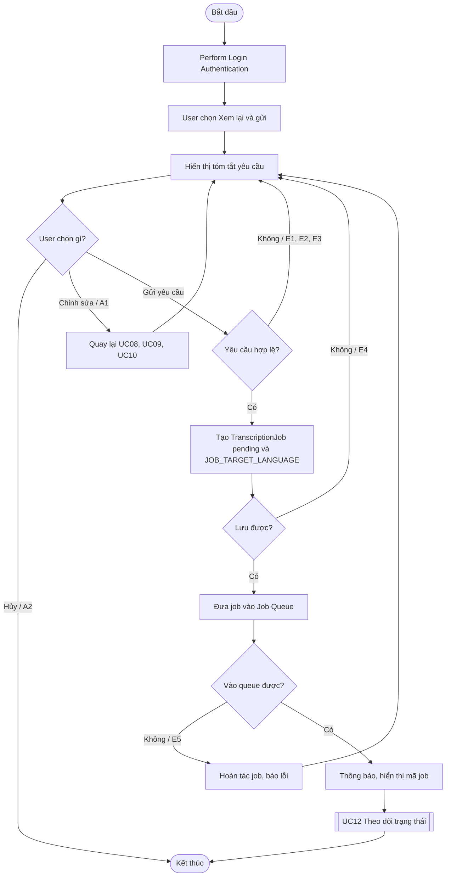

---

## UC12 — Theo dõi trạng thái xử lý job (real-time/polling)

### Use Case Diagram

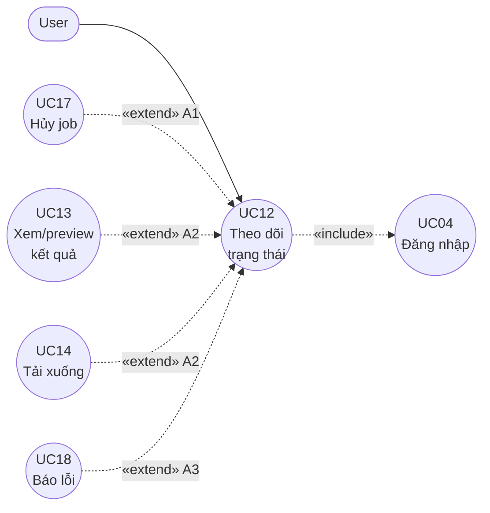

| Field | Content |
|---|---|
| **Use Case Number** | UC12 |
| **Use Case Name** | Theo dõi trạng thái xử lý job (real-time/polling) |
| **Actor(s)** | *User* |
| **Maturity** | Focused |
| **Summary** | *User* xem trạng thái xử lý của một job và nhận cập nhật tự động (real-time hoặc polling) cho tới khi job kết thúc. |

### Basic Course of Events

| Actor Action | System Response |
|---|---|
| 1. Perform **{Login Authentication}** | |
| | 2. Hệ thống hiển thị trang chủ người dùng với các chức năng. |
| 3. Use case bắt đầu khi User mở màn hình theo dõi của một job (sau UC11 hoặc từ lịch sử UC15). | |
| | 4. Hệ thống kiểm tra job thuộc User và hiển thị: tên tệp, ngôn ngữ nguồn, các ngôn ngữ đích, trạng thái hiện tại (`pending`, `processing`, `done`, `failed`, `canceled`), `createdAt` và `completedAt` (nếu có). **E1** |
| | 5. Trong khi job chưa kết thúc, hệ thống tự cập nhật trạng thái theo real-time hoặc polling định kỳ mà không cần User tải lại trang. **E2** |
| 6. User theo dõi trạng thái. **A1, A2, A3, A4** | |
| | 7. Khi job kết thúc, hệ thống dừng cập nhật và hiển thị kết quả cuối cùng (hoàn tất hoặc lỗi). <br><br>*Use case kết thúc.* |

### Alternative Paths

**A1.** Khi job đang `pending` hoặc `processing`, User chọn "Hủy job". Thực hiện **{Hủy job đang xử lý}** (UC17).

**A2.** Khi job `done`, User chọn "Xem kết quả" hoặc "Tải xuống". Thực hiện **{Xem/preview kết quả}** (UC13) hoặc **{Tải xuống file kết quả}** (UC14).

**A3.** Khi job `failed`, hệ thống hiển thị lý do lỗi tóm tắt; User có thể chọn "Báo lỗi". Thực hiện **{Báo lỗi kết quả xử lý}** (UC18).

**A4.** User rời màn hình theo dõi. Job vẫn tiếp tục xử lý; khi kết thúc, hệ thống gửi thông báo cho User (UC30). Use case kết thúc.

### Exception Paths

**E1.** Nếu job không tồn tại, không thuộc User hoặc đã bị xóa, hệ thống thông báo không tìm thấy và đưa User về lịch sử xử lý (UC15). Use case kết thúc.

**E2.** Nếu kết nối real-time bị mất, hệ thống chuyển sang polling. Nếu vẫn không cập nhật được, hệ thống hiển thị trạng thái đã biết gần nhất kèm thông báo "Không thể cập nhật" và nút "Thử lại". Quay lại bước 5.

### Other Fields

| Field | Content |
|---|---|
| **Extension Points** | **{Hủy job đang xử lý}** (A1), **{Xem/preview kết quả}** và **{Tải xuống file kết quả}** (A2), **{Báo lỗi kết quả xử lý}** (A3) |
| **Triggers** | User vừa gửi yêu cầu (UC11) hoặc muốn kiểm tra một job trong lịch sử (UC15). |
| **Assumptions** | Trạng thái job trong cơ sở dữ liệu được AI Pipeline cập nhật kịp thời. |
| **Preconditions** | User đã đăng nhập; job tồn tại và thuộc User. |
| **Post Conditions** | User biết trạng thái mới nhất của job; không có dữ liệu nào bị thay đổi. |
| **Reference: Business Rules** | BR-12.1: Chỉ chủ sở hữu job mới xem được trạng thái. <br>BR-12.2: Trạng thái gồm `pending`, `processing`, `done`, `failed`, `canceled`. <br>BR-12.3: Chu kỳ polling do cấu hình hệ thống quyết định. <br>BR-12.4: Khi job ở trạng thái kết thúc (`done`, `failed`, `canceled`), hệ thống ngừng cập nhật tự động. |
| **Author(s)** | Nhóm Đồ án |
| **Date** | 28-09-26 |

### Activity Diagram

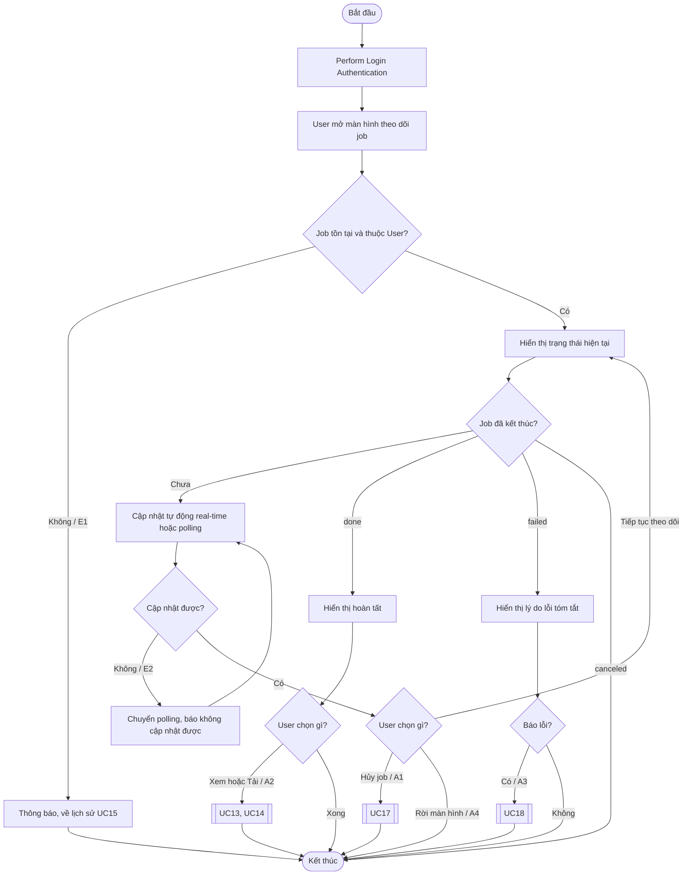

## UC13 — Xem/preview kết quả thuyết minh (audio/video output)

### Use Case Diagram

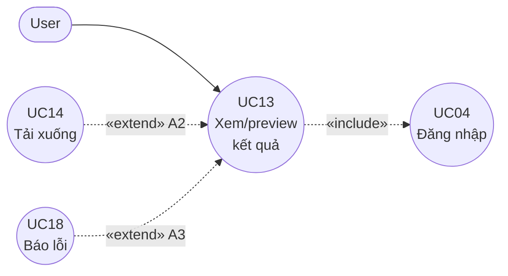

| Field | Content |
|---|---|
| **Use Case Number** | UC13 |
| **Use Case Name** | Xem/preview kết quả thuyết minh (audio/video output) |
| **Actor(s)** | *User* |
| **Maturity** | Focused |
| **Summary** | *User* xem hoặc nghe thử kết quả thuyết minh của một job đã hoàn tất, theo từng ngôn ngữ đích, trước khi tải xuống. |

### Basic Course of Events

| Actor Action | System Response |
|---|---|
| 1. Perform **{Login Authentication}** | |
| | 2. Hệ thống hiển thị trang chủ người dùng với các chức năng. |
| 3. Use case bắt đầu khi User chọn "Xem kết quả" của một job (từ UC12 hoặc lịch sử UC15). | |
| | 4. Hệ thống kiểm tra job thuộc User và có `status = done`, sau đó hiển thị danh sách các ngôn ngữ đích có kết quả. **E1** |
| 5. User chọn một ngôn ngữ đích. **A1** | |
| | 6. Hệ thống lấy kết quả tương ứng (`resultFileUrl` của `JOB_TARGET_LANGUAGE`) và phát trên trình phát: video có thuyết minh nếu tệp nguồn là video, audio thuyết minh nếu tệp nguồn là audio. **E2, E3** |
| 7. User xem hoặc nghe kết quả. **A1, A2, A3** <br><br>*Use case kết thúc.* | |

### Alternative Paths

**A1.** User chọn ngôn ngữ đích khác. Quay lại bước 6 của Basic Course of Events.

**A2.** User chọn "Tải xuống". Thực hiện **{Tải xuống file kết quả}** (UC14).

**A3.** User chọn "Báo lỗi". Thực hiện **{Báo lỗi kết quả xử lý}** (UC18).

### Exception Paths

**E1.** Nếu job không tồn tại, không thuộc User hoặc chưa ở trạng thái `done`, hệ thống thông báo chưa có kết quả và đưa User về màn hình theo dõi (UC12). Use case kết thúc.

**E2.** Nếu tệp kết quả không còn tồn tại trong storage (bị xóa hoặc hết hạn lưu trữ), hệ thống thông báo không tìm thấy kết quả. Quay lại bước 5 để chọn ngôn ngữ khác.

**E3.** Nếu không phát được (lỗi định dạng hoặc mất kết nối), hệ thống thông báo lỗi kèm nút "Thử lại". Quay lại bước 6.

### Other Fields

| Field | Content |
|---|---|
| **Extension Points** | **{Tải xuống file kết quả}** (A2), **{Báo lỗi kết quả xử lý}** (A3) |
| **Triggers** | Job đã hoàn tất và User muốn kiểm tra chất lượng thuyết minh. |
| **Assumptions** | Thiết bị của User phát được định dạng video/audio kết quả. |
| **Preconditions** | User đã đăng nhập; job thuộc User và có `status = done`. |
| **Post Conditions** | User đã xem hoặc nghe kết quả; không có dữ liệu nào bị thay đổi. |
| **Reference: Business Rules** | BR-13.1: Chỉ job có `status = done` mới xem được kết quả. <br>BR-13.2: Chỉ chủ sở hữu job mới xem được kết quả. <br>BR-13.3: Kết quả truy cập qua đường dẫn có thời hạn, không công khai. <br>BR-13.4: Loại kết quả theo loại đầu vào (video có thuyết minh hoặc audio thuyết minh). |
| **Author(s)** | Nhóm Đồ án |
| **Date** | 28-09-26 |

### Activity Diagram

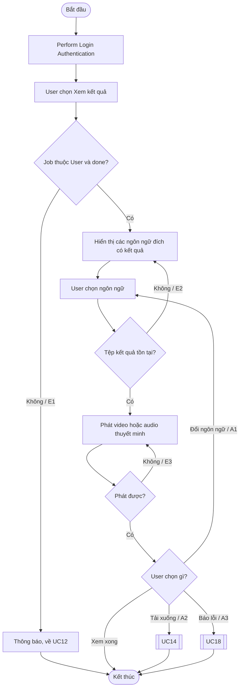

---

## UC14 — Tải xuống file kết quả

### Use Case Diagram

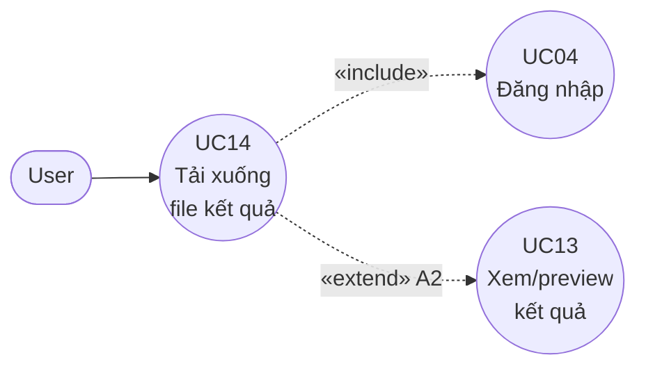

| Field | Content |
|---|---|
| **Use Case Number** | UC14 |
| **Use Case Name** | Tải xuống file kết quả |
| **Actor(s)** | *User* |
| **Maturity** | Focused |
| **Summary** | *User* tải về thiết bị tệp kết quả (video có thuyết minh hoặc audio thuyết minh) của một job đã hoàn tất, theo từng ngôn ngữ đích hoặc tất cả. |

### Basic Course of Events

| Actor Action | System Response |
|---|---|
| 1. Perform **{Login Authentication}** | |
| | 2. Hệ thống hiển thị trang chủ người dùng với các chức năng. |
| 3. Use case bắt đầu khi User chọn "Tải xuống" của một job (từ UC13, UC12 hoặc lịch sử UC15). | |
| | 4. Hệ thống kiểm tra job thuộc User và có `status = done`, sau đó hiển thị các ngôn ngữ đích có kết quả kèm loại và dung lượng tệp. **E1** |
| 5. User chọn một ngôn ngữ đích và chọn "Tải xuống". **A1** | |
| | 6. Hệ thống kiểm tra tệp kết quả còn tồn tại và tạo liên kết tải có thời hạn. **E2** |
| | 7. Hệ thống bắt đầu tải tệp về thiết bị và hiển thị tiến trình. **A2, E3** |
| | 8. Hệ thống thông báo tải hoàn tất. <br><br>*Use case kết thúc.* |

### Alternative Paths

**A1.** User chọn "Tải tất cả ngôn ngữ". Hệ thống gói các tệp kết quả thành một tệp nén và tải về. Tiếp tục bước 6 của Basic Course of Events.

**A2.** User hủy tải khi đang tải. Hệ thống dừng việc tải, không ảnh hưởng dữ liệu của job. Quay lại bước 4.

### Exception Paths

**E1.** Nếu job không tồn tại, không thuộc User hoặc chưa ở trạng thái `done`, hệ thống thông báo chưa có kết quả và đưa User về màn hình theo dõi (UC12). Use case kết thúc.

**E2.** Nếu tệp kết quả không còn tồn tại trong storage, hệ thống thông báo không tìm thấy tệp. Quay lại bước 4.

**E3.** Nếu quá trình tải bị gián đoạn (mất kết nối), hệ thống thông báo lỗi và cho User thử tải lại. Quay lại bước 5.

### Other Fields

| Field | Content |
|---|---|
| **Extension Points** | None |
| **Triggers** | Job đã hoàn tất và User muốn lưu kết quả về thiết bị. |
| **Assumptions** | Thiết bị còn đủ dung lượng trống. |
| **Preconditions** | User đã đăng nhập; job thuộc User và có `status = done`. |
| **Post Conditions** | Tệp kết quả được lưu trên thiết bị của User; dữ liệu của job không đổi. |
| **Reference: Business Rules** | BR-14.1: Chỉ job có `status = done` mới tải được. <br>BR-14.2: Chỉ chủ sở hữu job mới tải được. <br>BR-14.3: Liên kết tải có thời hạn và chỉ dùng cho phiên hiện tại. <br>BR-14.4: Tên tệp tải về gồm tên tệp gốc và mã ngôn ngữ đích. <br>BR-14.5: Tải nhiều ngôn ngữ được nén thành một tệp. |
| **Author(s)** | Nhóm Đồ án |
| **Date** | 28-09-26 |

### Activity Diagram

```mermaid
flowchart TD
    A([Bắt đầu]) --> B[Perform Login Authentication]
    B --> C[User chọn Tải xuống]
    C --> D{Job thuộc User và done?}
    D -- Không / E1 --> Y[Thông báo, về UC12]
    Y --> Z([Kết thúc])
    D -- Có --> E[Hiển thị ngôn ngữ và loại tệp]
    E --> F[User chọn ngôn ngữ hoặc tất cả / A1]
    F --> G{Tệp còn tồn tại?}
    G -- Không / E2 --> E
    G -- Có --> H[Tạo liên kết tải có thời hạn]
    H --> I[Bắt đầu tải, hiển thị tiến trình]
    I --> J{User hủy?}
    J -- Có / A2 --> E
    J -- Không --> K{Tải thành công?}
    K -- Không / E3 --> F
    K -- Có --> L[Thông báo tải hoàn tất]
    L --> Z
```

---

## UC15 — Xem lịch sử các job đã xử lý

### Use Case Diagram

```mermaid
flowchart LR
    U([User])
    UC15((UC15<br/>Xem lịch sử<br/>job))
    LG((UC04<br/>Đăng nhập))
    UC12((UC12<br/>Theo dõi))
    UC13((UC13<br/>Xem kết quả))
    UC14((UC14<br/>Tải xuống))
    UC16((UC16<br/>Xóa job))
    UC17((UC17<br/>Hủy job))
    UC18((UC18<br/>Báo lỗi))
    U --> UC15
    UC15 -. "«include»" .-> LG
    UC12 -. "«extend» A4" .-> UC15
    UC13 -. "«extend» A4" .-> UC15
    UC14 -. "«extend» A4" .-> UC15
    UC16 -. "«extend» A4" .-> UC15
    UC17 -. "«extend» A4" .-> UC15
    UC18 -. "«extend» A4" .-> UC15
```

| Field | Content |
|---|---|
| **Use Case Number** | UC15 |
| **Use Case Name** | Xem lịch sử các job đã xử lý |
| **Actor(s)** | *User* |
| **Maturity** | Focused |
| **Summary** | *User* xem danh sách các job mình đã tạo, lọc và tìm kiếm, rồi mở chi tiết một job để thực hiện các thao tác phù hợp với trạng thái. |

### Basic Course of Events

| Actor Action | System Response |
|---|---|
| 1. Perform **{Login Authentication}** | |
| | 2. Hệ thống hiển thị trang chủ người dùng với các chức năng. |
| 3. User chọn "Lịch sử xử lý" (Web: trang Lịch sử xử lý; Mobile: History Screen). | |
| | 4. Hệ thống tải danh sách job của User (không gồm job đã xóa), sắp xếp mới nhất trước và phân trang. Mỗi dòng gồm: tên tệp, ngôn ngữ nguồn, các ngôn ngữ đích, trạng thái, `createdAt`. **E1, E2** |
| 5. User chọn một job để xem chi tiết. **A1, A2, A3** | |
| | 6. Hệ thống hiển thị chi tiết job: thông tin đầy đủ, các ngôn ngữ đích, `createdAt`, `completedAt`, cùng các thao tác phù hợp với trạng thái hiện tại. **A4** <br><br>*Use case kết thúc.* |

### Alternative Paths

**A1.** User lọc danh sách theo trạng thái hoặc khoảng thời gian. Hệ thống hiển thị các job khớp. Quay lại bước 5 của Basic Course of Events.

**A2.** User nhập tên tệp vào ô tìm kiếm. Hệ thống hiển thị các job khớp. Quay lại bước 5.

**A3.** User chuyển trang hoặc cuộn để tải thêm. Hệ thống tải trang tiếp theo. Quay lại bước 5.

**A4.** Từ chi tiết job, User chọn một thao tác: theo dõi (UC12), xem kết quả (UC13), tải xuống (UC14), xóa (UC16), hủy (UC17) hoặc báo lỗi (UC18). Hệ thống chỉ cung cấp thao tác phù hợp với trạng thái của job. Thực hiện use case tương ứng.

### Exception Paths

**E1.** Nếu User chưa có job nào (hoặc bộ lọc không có kết quả), hệ thống hiển thị "Chưa có job nào" kèm gợi ý tạo thuyết minh mới (UC08). Use case kết thúc.

**E2.** Nếu không tải được danh sách (lỗi hệ thống hoặc mất kết nối), hệ thống thông báo lỗi kèm nút "Thử lại". Quay lại bước 4.

### Other Fields

| Field | Content |
|---|---|
| **Extension Points** | **{Theo dõi trạng thái xử lý job}**, **{Xem/preview kết quả}**, **{Tải xuống file kết quả}**, **{Xóa job}**, **{Hủy job đang xử lý}**, **{Báo lỗi kết quả xử lý}** (A4) |
| **Triggers** | User muốn xem lại các job đã thực hiện hoặc tìm một kết quả cũ. |
| **Assumptions** | Lịch sử chỉ chứa job do chính User tạo. |
| **Preconditions** | User đã đăng nhập. |
| **Post Conditions** | User xem được danh sách và chi tiết job; không có dữ liệu nào bị thay đổi. |
| **Reference: Business Rules** | BR-15.1: Chỉ hiển thị job có `userId` là User hiện tại. <br>BR-15.2: Job đã bị xóa (`deletedAt` có giá trị) không hiển thị. <br>BR-15.3: Sắp xếp mặc định theo `createdAt` giảm dần. <br>BR-15.4: Danh sách được phân trang với kích thước do cấu hình quyết định. <br>BR-15.5: Thao tác khả dụng phụ thuộc trạng thái job (ví dụ chỉ `done` mới có xem và tải, chỉ `pending`/`processing` mới có hủy). |
| **Author(s)** | Nhóm Đồ án |
| **Date** | 28-09-26 |

### Activity Diagram

```mermaid
flowchart TD
    A([Bắt đầu]) --> B[Perform Login Authentication]
    B --> C[User chọn Lịch sử xử lý]
    C --> D[Tải danh sách job của User, phân trang]
    D --> E{Tải được?}
    E -- Không / E2 --> D
    E -- Có --> F{Có job?}
    F -- Không / E1 --> Y[Hiển thị Chưa có job, gợi ý tạo mới]
    Y --> Z([Kết thúc])
    F -- Có --> G[Hiển thị danh sách]
    G --> H{User chọn gì?}
    H -- Lọc hoặc tìm kiếm / A1, A2 --> D
    H -- Chuyển trang / A3 --> D
    H -- Chọn job --> I[Hiển thị chi tiết job và thao tác theo trạng thái]
    I --> J{User chọn thao tác?}
    J -- Có / A4 --> U[[UC12, UC13, UC14, UC16, UC17, UC18]]
    J -- Không --> Z
    U --> Z
```

---

## UC16 — Xóa job / xóa file khỏi lịch sử

### Use Case Diagram

```mermaid
flowchart LR
    U([User])
    UC16((UC16<br/>Xóa job/<br/>xóa file))
    LG((UC04<br/>Đăng nhập))
    UC15((UC15<br/>Xem lịch sử))
    UC17((UC17<br/>Hủy job))
    U --> UC16
    UC16 -. "«include»" .-> LG
    UC16 -. "«extend» A4" .-> UC15
    UC17 -. "gợi ý ở E2" .-> UC16
```

| Field | Content |
|---|---|
| **Use Case Number** | UC16 |
| **Use Case Name** | Xóa job / xóa file khỏi lịch sử |
| **Actor(s)** | *User* |
| **Maturity** | Focused |
| **Summary** | *User* xóa một hoặc nhiều job đã kết thúc khỏi lịch sử, đồng thời xóa tệp nguồn và tệp kết quả liên quan khỏi File Storage. |

### Basic Course of Events

| Actor Action | System Response |
|---|---|
| 1. Perform **{Login Authentication}** | |
| | 2. Hệ thống hiển thị trang chủ người dùng với các chức năng. |
| 3. Use case bắt đầu khi User chọn "Xóa" một job trong lịch sử (từ danh sách hoặc chi tiết job). **A1** | |
| | 4. Hệ thống kiểm tra job thuộc User và có trạng thái `done`, `failed` hoặc `canceled`. **E1, E2** |
| | 5. Hệ thống hiển thị hộp thoại xác nhận, nêu rõ tệp nguồn và các tệp kết quả sẽ bị xóa vĩnh viễn. |
| 6. User xác nhận xóa. **A2** | |
| | 7. Hệ thống đánh dấu job đã xóa (`deletedAt`) để ẩn khỏi lịch sử. **E3** |
| | 8. Hệ thống xóa tệp nguồn và các tệp kết quả của job khỏi File Storage. **E4** |
| | 9. Hệ thống thông báo đã xóa và cập nhật lại danh sách lịch sử. <br><br>*Use case kết thúc.* |

### Alternative Paths

**A1.** User chọn nhiều job và chọn "Xóa". Hệ thống thực hiện bước 4 đến 8 cho từng job; các job không hợp lệ được bỏ qua và liệt kê lý do trong thông báo ở bước 9.

**A2.** User chọn "Hủy" ở hộp thoại xác nhận. Hệ thống không xóa gì và quay lại danh sách lịch sử. Use case kết thúc.

### Exception Paths

**E1.** Nếu job không tồn tại, đã bị xóa hoặc không thuộc User, hệ thống thông báo không tìm thấy và cập nhật lại danh sách. Use case kết thúc.

**E2.** Nếu job đang `pending` hoặc `processing`, hệ thống từ chối xóa và gợi ý hủy job trước (UC17). Use case kết thúc.

**E3.** Nếu không đánh dấu xóa được (lỗi cơ sở dữ liệu), hệ thống thông báo lỗi, không xóa tệp nào và cho User thử lại. Use case kết thúc.

**E4.** Nếu không xóa được tệp trong storage, hệ thống vẫn xem job là đã xóa với User, ghi nhận tệp cần dọn và thử xóa lại ở tiến trình nền. Tiếp tục bước 9.

### Other Fields

| Field | Content |
|---|---|
| **Extension Points** | None |
| **Triggers** | User muốn dọn lịch sử hoặc giải phóng dung lượng lưu trữ. |
| **Assumptions** | `TranscriptionJob` có thêm trường `deletedAt` (xem Ghi chú thiết kế). |
| **Preconditions** | User đã đăng nhập; job thuộc User và đã kết thúc (`done`, `failed` hoặc `canceled`). |
| **Post Conditions** | Job không còn hiển thị trong lịch sử; tệp nguồn và tệp kết quả bị xóa khỏi storage. |
| **Reference: Business Rules** | BR-16.1: Chỉ xóa được job đã kết thúc; job đang xử lý phải hủy trước. <br>BR-16.2: Việc xóa không thể hoàn tác. <br>BR-16.3: Bản ghi job được giữ lại dưới dạng xóa mềm để phục vụ thống kê (UC20, UC23) nhưng không hiển thị và không truy cập được với User. <br>BR-16.4: Tệp xóa lỗi được thử lại ở tiến trình nền. |
| **Author(s)** | Nhóm Đồ án |
| **Date** | 28-09-26 |

### Activity Diagram

```mermaid
flowchart TD
    A([Bắt đầu]) --> B[Perform Login Authentication]
    B --> C[User chọn Xóa job / A1 chọn nhiều]
    C --> D{Job thuộc User và tồn tại?}
    D -- Không / E1 --> Z([Kết thúc])
    D -- Có --> E{Job đã kết thúc?}
    E -- Chưa / E2 --> Y[Từ chối, gợi ý Hủy job UC17]
    Y --> Z
    E -- Rồi --> F[Hiển thị xác nhận xóa vĩnh viễn]
    F --> G{User xác nhận?}
    G -- Không / A2 --> Z
    G -- Có --> H[Đánh dấu deletedAt]
    H --> I{Đánh dấu được?}
    I -- Không / E3 --> Z
    I -- Có --> J[Xóa tệp nguồn và tệp kết quả trong storage]
    J --> K{Xóa được?}
    K -- Không / E4 --> L[Ghi nhận, thử lại nền]
    K -- Có --> M[Thông báo đã xóa, cập nhật lịch sử]
    L --> M
    M --> Z
```

---

## UC17 — Hủy job đang xử lý

### Use Case Diagram

```mermaid
flowchart LR
    U([User])
    UC17((UC17<br/>Hủy job<br/>đang xử lý))
    LG((UC04<br/>Đăng nhập))
    UC12((UC12<br/>Theo dõi))
    UC15((UC15<br/>Xem lịch sử))
    U --> UC17
    UC17 -. "«include»" .-> LG
    UC17 -. "«extend» A1" .-> UC12
    UC17 -. "«extend» A4" .-> UC15
```

| Field | Content |
|---|---|
| **Use Case Number** | UC17 |
| **Use Case Name** | Hủy job đang xử lý |
| **Actor(s)** | *User* |
| **Maturity** | Focused |
| **Summary** | *User* dừng một job đang chờ hoặc đang xử lý; hệ thống ngừng pipeline cho job đó và chuyển trạng thái sang `canceled`. |

### Basic Course of Events

| Actor Action | System Response |
|---|---|
| 1. Perform **{Login Authentication}** | |
| | 2. Hệ thống hiển thị trang chủ người dùng với các chức năng. |
| 3. Use case bắt đầu khi User chọn "Hủy job" của một job (từ UC12 hoặc lịch sử UC15). | |
| | 4. Hệ thống kiểm tra job thuộc User và đang `pending` hoặc `processing`, sau đó hiển thị xác nhận nêu rõ kết quả dở dang sẽ bị bỏ. **E1, E2** |
| 5. User xác nhận hủy. **A1** | |
| | 6. Hệ thống gửi yêu cầu hủy: nếu `pending` thì gỡ job khỏi Job Queue; nếu `processing` thì yêu cầu Worker dừng xử lý. **E3** |
| | 7. Hệ thống xóa dữ liệu trung gian và kết quả dở dang của job. |
| | 8. Hệ thống cập nhật `status = canceled` và `completedAt`. |
| | 9. Hệ thống thông báo đã hủy job. <br><br>*Use case kết thúc.* |

### Alternative Paths

**A1.** User chọn "Không" ở hộp thoại xác nhận. Job tiếp tục được xử lý bình thường. Use case kết thúc.

### Exception Paths

**E1.** Nếu job không tồn tại hoặc không thuộc User, hệ thống thông báo không tìm thấy. Use case kết thúc.

**E2.** Nếu job đã kết thúc (`done`, `failed` hoặc `canceled`), kể cả khi vừa hoàn tất trong lúc User đang xác nhận, hệ thống thông báo không thể hủy và hiển thị trạng thái hiện tại. Use case kết thúc.

**E3.** Nếu không dừng được job (Worker không phản hồi hoặc lỗi hệ thống), hệ thống giữ nguyên trạng thái hiện tại của job, thông báo lỗi và cho User thử lại. Use case kết thúc.

### Other Fields

| Field | Content |
|---|---|
| **Extension Points** | None |
| **Triggers** | User gửi nhầm yêu cầu, chọn sai ngôn ngữ hoặc không còn cần kết quả. |
| **Assumptions** | Worker có cơ chế nhận tín hiệu hủy giữa các bước của pipeline; trạng thái `canceled` được thêm vào tập trạng thái job (xem Ghi chú thiết kế). |
| **Preconditions** | User đã đăng nhập; job thuộc User và đang `pending` hoặc `processing`. |
| **Post Conditions** | Job có `status = canceled`; pipeline dừng, dữ liệu dở dang bị xóa; job vẫn hiển thị trong lịch sử. |
| **Reference: Business Rules** | BR-17.1: Chỉ hủy được job `pending` hoặc `processing`. <br>BR-17.2: Hủy không thể hoàn tác; muốn xử lý lại phải gửi job mới. <br>BR-17.3: Job `canceled` không còn tính vào hạn mức số job đang xử lý của User. <br>BR-17.4: Job `canceled` vẫn nằm trong lịch sử và có thể xóa bằng UC16. |
| **Author(s)** | Nhóm Đồ án |
| **Date** | 28-09-26 |

### Activity Diagram

```mermaid
flowchart TD
    A([Bắt đầu]) --> B[Perform Login Authentication]
    B --> C[User chọn Hủy job]
    C --> D{Job thuộc User?}
    D -- Không / E1 --> Z([Kết thúc])
    D -- Có --> E{Job đang pending hoặc processing?}
    E -- Không / E2 --> Y[Thông báo không thể hủy, hiển thị trạng thái]
    Y --> Z
    E -- Có --> F[Hiển thị xác nhận hủy]
    F --> G{User xác nhận?}
    G -- Không / A1 --> Z
    G -- Có --> H{Trạng thái?}
    H -- pending --> I[Gỡ job khỏi Job Queue]
    H -- processing --> J[Yêu cầu Worker dừng]
    I --> K{Hủy được?}
    J --> K
    K -- Không / E3 --> X[Giữ trạng thái, báo lỗi]
    X --> Z
    K -- Có --> L[Xóa dữ liệu trung gian và kết quả dở dang]
    L --> M[Cập nhật status canceled và completedAt]
    M --> N[Thông báo đã hủy]
    N --> Z
```

---

## UC18 — Báo lỗi kết quả xử lý (feedback/report)

### Use Case Diagram

```mermaid
flowchart LR
    U([User])
    UC18((UC18<br/>Báo lỗi<br/>kết quả))
    LG((UC04<br/>Đăng nhập))
    VR((Validate<br/>Report))
    UC12((UC12<br/>Theo dõi))
    UC13((UC13<br/>Xem kết quả))
    UC15((UC15<br/>Xem lịch sử))
    U --> UC18
    UC18 -. "«include»" .-> LG
    UC18 -. "«include»" .-> VR
    UC18 -. "«extend» A3" .-> UC12
    UC18 -. "«extend» A3" .-> UC13
    UC18 -. "«extend» A4" .-> UC15
```

| Field | Content |
|---|---|
| **Use Case Number** | UC18 |
| **Use Case Name** | Báo lỗi kết quả xử lý (feedback/report) |
| **Actor(s)** | *User* |
| **Maturity** | Focused |
| **Summary** | *User* gửi báo cáo khi kết quả thuyết minh không đúng (dịch sai, giọng đọc sai, lệch thời gian…) hoặc khi job thất bại, để quản trị viên theo dõi và cải thiện hệ thống. |

### Basic Course of Events

| Actor Action | System Response |
|---|---|
| 1. Perform **{Login Authentication}** | |
| | 2. Hệ thống hiển thị trang chủ người dùng với các chức năng. |
| 3. Use case bắt đầu khi User chọn "Báo lỗi" của một job (từ UC12, UC13 hoặc lịch sử UC15). | |
| | 4. Hệ thống kiểm tra job thuộc User và có trạng thái `done` hoặc `failed`, sau đó hiển thị form báo lỗi: ngôn ngữ đích liên quan (tùy chọn), loại lỗi, mô tả chi tiết. **E1** |
| 5. User chọn loại lỗi, nhập mô tả và chọn "Gửi báo lỗi". **A1** | |
| | 6. Hệ thống kiểm tra nội dung báo lỗi. **{Validate Report}** **E2** |
| | 7. Hệ thống lưu báo lỗi (`JobReport`) liên kết với job và User, kèm thời điểm gửi. **E3** |
| | 8. Hệ thống thông báo đã ghi nhận báo lỗi; báo lỗi được quản trị viên xem qua chức năng theo dõi job lỗi (UC21). <br><br>*Use case kết thúc.* |

### Alternative Paths

**A1.** User chọn "Hủy". Hệ thống bỏ nội dung đã nhập và quay lại màn hình trước. Use case kết thúc.

### Exception Paths

**E1.** Nếu job không tồn tại, không thuộc User hoặc chưa kết thúc (`pending`, `processing`), hệ thống thông báo không thể báo lỗi cho job này. Use case kết thúc.

**E2.** Tại **{Validate Report}**, nếu chưa chọn loại lỗi, hoặc chọn "Lỗi khác" mà bỏ trống mô tả, hoặc mô tả vượt độ dài cho phép, hệ thống đánh dấu trường lỗi. Quay lại bước 5.

**E3.** Nếu không lưu được báo lỗi (lỗi cơ sở dữ liệu), hệ thống thông báo lỗi và giữ nguyên nội dung đã nhập để User gửi lại. Quay lại bước 5.

### Other Fields

| Field | Content |
|---|---|
| **Extension Points** | **{Validate Report}** — Kiểm tra loại lỗi bắt buộc, mô tả bắt buộc khi chọn "Lỗi khác", và độ dài mô tả. (Xem BR-18.2, BR-18.3) **E2** |
| **Triggers** | User thấy kết quả sai hoặc job bị lỗi và muốn phản hồi. |
| **Assumptions** | Có thực thể `JobReport` để lưu báo lỗi (xem Ghi chú thiết kế). |
| **Preconditions** | User đã đăng nhập; job thuộc User và có trạng thái `done` hoặc `failed`. |
| **Post Conditions** | Một `JobReport` mới được lưu và liên kết với job; trạng thái job không thay đổi. |
| **Reference: Business Rules** | BR-18.1: Chỉ báo lỗi cho job của chính User và đã kết thúc ở trạng thái `done` hoặc `failed`. <br>BR-18.2: Loại lỗi chọn từ danh mục có sẵn (ví dụ: dịch sai, giọng đọc sai hoặc khó nghe, lệch thời gian, không phát được, lỗi khác). <br>BR-18.3: Mô tả tối đa 1000 ký tự. <br>BR-18.4: Báo lỗi được liên kết với job để Admin xem ở UC21. <br>BR-18.5: Việc báo lỗi không làm thay đổi trạng thái job và không tự động xử lý lại job. |
| **Author(s)** | Nhóm Đồ án |
| **Date** | 28-09-26 |

### Activity Diagram

```mermaid
flowchart TD
    A([Bắt đầu]) --> B[Perform Login Authentication]
    B --> C[User chọn Báo lỗi]
    C --> D{Job thuộc User và đã kết thúc?}
    D -- Không / E1 --> Z([Kết thúc])
    D -- Có --> E[Hiển thị form báo lỗi]
    E --> F{User hủy?}
    F -- Có / A1 --> Z
    F -- Không --> G[User chọn loại lỗi, nhập mô tả, gửi]
    G --> H{Nội dung hợp lệ?}
    H -- Không / E2 --> E
    H -- Có --> I[Lưu JobReport]
    I --> J{Lưu được?}
    J -- Không / E3 --> E
    J -- Có --> K[Thông báo đã ghi nhận]
    K --> Z
```

---

## Bảng truy vết UC ↔ dữ liệu ↔ UC hệ thống

| UC | Thực thể / trường chính (PRD mục 5, 9) | UC System liên quan (PRD mục 6) |
|---|---|---|
| UC05 | `UserSession` (token, expiresAt) | — |
| UC06 | `User` (fullName, avatarUrl, preferredLanguage, updatedAt) | — |
| UC07 | `User` (password hashed, updatedAt), `UserSession` | — |
| UC08 | `TranscriptionJob.sourceFileUrl` (File Storage) | UC24 (trích xuất audio, ở bước xử lý sau) |
| UC09 | `TranscriptionJob.sourceLanguage`, `LANGUAGE.isSupported` | UC25 (Speech-to-Text) |
| UC10 | `TranscriptionJob.targetLanguages[]`, `JOB_TARGET_LANGUAGE`, `LANGUAGE` | UC26, UC27 |
| UC11 | `TranscriptionJob` (status = pending), `JOB_TARGET_LANGUAGE`, Job Queue | UC24–UC29 |
| UC12 | `TranscriptionJob.status`, `createdAt`, `completedAt` | UC30 (thông báo hoàn tất) |
| UC13 | `JOB_TARGET_LANGUAGE.resultFileUrl` | UC28, UC29 |
| UC14 | `JOB_TARGET_LANGUAGE.resultFileUrl` | UC29 |
| UC15 | `TranscriptionJob` (theo `userId`) | — |
| UC16 | `TranscriptionJob.deletedAt` *(đề xuất mới)*, File Storage | — |
| UC17 | `TranscriptionJob.status = canceled` *(đề xuất mới)*, Job Queue, Worker | UC24–UC29 (dừng giữa chừng) |
| UC18 | `JobReport` *(đề xuất mới)* | UC21 (Admin theo dõi job lỗi) |

---
