# Thuyết minh tự động đa ngôn ngữ — Focused Use Cases (Actor: Admin)

**Version 1.0**

> Theo mẫu `FocusedusecasesGuest.md` (cấu trúc lấy từ `FocusedUseCases.md` — Course Cast) và danh sách Use Case trong PRD (mục 6, Actor: Admin). Nhãn trường giữ tiếng Anh như mẫu, nội dung tiếng Việt.

## Revision History

| Date     | Version | Description                                                                  | Author     |
|----------|---------|------------------------------------------------------------------------------|------------|
| 28-09-26 | 1.0     | Bản đầu: UC19–UC23, Use Case Diagram, Activity Diagrams (Admin)              | Nhóm Đồ án |

## Table of Contents

| Mã   | Use Case                            |
|------|-------------------------------------|
| [UC19](#uc19--quản-lý-danh-sách-người-dùng) | Quản lý danh sách người dùng (khóa/mở tài khoản) |
| [UC20](#uc20--xem-thống-kê-số-lượng-job-xử-lý) | Xem thống kê số lượng job xử lý |
| [UC21](#uc21--theo-dõi-job-lỗi-và-log-hệ-thống) | Theo dõi job lỗi (failed jobs) và log hệ thống |
| [UC22](#uc22--quản-lý-danh-sách-ngôn-ngữ-hỗ-trợ) | Quản lý danh sách ngôn ngữ hỗ trợ (thêm/xóa/sửa) |
| [UC23](#uc23--xem-báo-cáo-hiệu-suất-hệ-thống) | Xem báo cáo hiệu suất hệ thống |

## Use Case Diagram tổng quan (Admin)

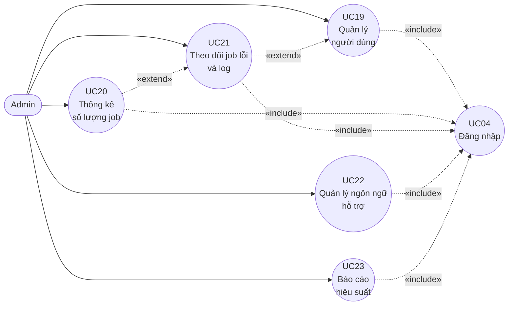

---

## UC19 — Quản lý danh sách người dùng

### Use Case Diagram

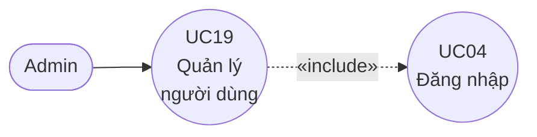

| Field | Content |
|---|---|
| **Use Case Number** | UC19 |
| **Use Case Name** | Quản lý danh sách người dùng (khóa/mở tài khoản) |
| **Actor(s)** | *Admin* |
| **Maturity** | Focused |
| **Summary** | *Admin* xem danh sách *User* đã đăng ký, tìm kiếm, lọc theo vai trò hoặc trạng thái, xem thông tin chi tiết và khóa hoặc mở khóa tài khoản để kiểm soát việc sử dụng hệ thống. |

### Basic Course of Events

| Actor Action | System Response |
|---|---|
| 1. Use case bắt đầu khi Admin chọn "Quản lý người dùng" trong trang quản trị. | |
| | 2. Hệ thống tải và hiển thị danh sách người dùng (`fullName`, `email`, `role`, `status`, `createdAt`), có phân trang. **E1** |
| 3. Admin tìm kiếm theo tên/email hoặc lọc theo `role`, `status`. **A1** | |
| | 4. Hệ thống hiển thị danh sách theo điều kiện tìm kiếm/lọc. |
| 5. Admin chọn một người dùng và chọn "Khóa tài khoản" (hoặc "Mở khóa"). **A2** | |
| | 6. Hệ thống kiểm tra Admin có quyền thao tác trên tài khoản đó. **{Validate Account Action}** **E2** |
| | 7. Hệ thống yêu cầu Admin xác nhận thao tác. |
| 8. Admin xác nhận. **A3** | |
| | 9. Hệ thống cập nhật `status` của tài khoản (`banned` khi khóa, `active` khi mở khóa) và ghi nhận thao tác. **E3** |
| | 10. Hệ thống thông báo cập nhật thành công và làm mới danh sách.   *Use case kết thúc.* |

### Alternative Paths

**A1.** Không có người dùng nào khớp điều kiện tìm kiếm/lọc. Hệ thống hiển thị "Không tìm thấy người dùng". Quay lại bước 3.

**A2.** Admin chọn "Xem chi tiết" thay vì khóa/mở khóa. Hệ thống hiển thị thông tin tài khoản (`fullName`, `email`, `role`, `status`, `createdAt`) và số job đã tạo. Quay lại bước 4.

**A3.** Admin chọn "Hủy" ở bước xác nhận. Hệ thống không thay đổi gì và quay lại bước 4.

### Exception Paths

**E1.** Nếu không tải được danh sách người dùng (lỗi máy chủ hoặc cơ sở dữ liệu), hệ thống hiển thị thông báo lỗi kèm nút "Thử lại". Quay lại bước 2.

**E2.** Tại **{Validate Account Action}**, nếu Admin cố khóa chính tài khoản của mình hoặc một tài khoản Admin khác, hệ thống từ chối và nêu lý do (BR-19.2). Quay lại bước 4.

**E3.** Nếu không cập nhật được trạng thái (lỗi cơ sở dữ liệu), hệ thống thông báo lỗi, giữ nguyên trạng thái cũ và cho Admin thử lại. Quay lại bước 4.

### Other Fields

| Field | Content |
|---|---|
| **Extension Points** | **{Validate Account Action}** — Kiểm tra tài khoản đích có được phép khóa/mở khóa hay không. (Xem BR-19.2) **E2** |
| **Triggers** | Admin cần khóa tài khoản vi phạm hoặc mở khóa tài khoản đã bị khóa. |
| **Assumptions** | Danh sách người dùng đã có dữ liệu trong hệ thống. |
| **Preconditions** | Admin đã đăng nhập (UC04) với `role = admin`. |
| **Post Conditions** | Trạng thái `status` của tài khoản được cập nhật; tài khoản `banned` không thể đăng nhập (theo UC04, BR-4.1). |
| **Reference: Business Rules** | BR-19.1: Chỉ vai trò Admin mới được truy cập chức năng này.  BR-19.2: Admin không được khóa chính mình hoặc tài khoản có `role = admin`.  BR-19.3: Khóa tài khoản đặt `status = banned`; mở khóa đặt `status = active`.  BR-19.4: Mọi thao tác khóa/mở khóa phải được ghi nhận (ai làm, khi nào). |
| **Author(s)** | Nhóm Đồ án |
| **Date** | 28-09-26 |

### Activity Diagram

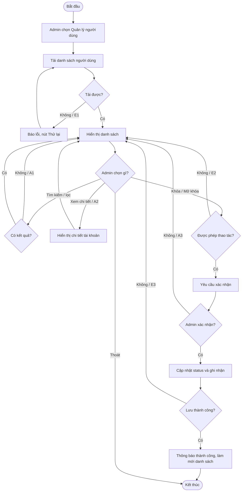

---

## UC20 — Xem thống kê số lượng job xử lý

### Use Case Diagram

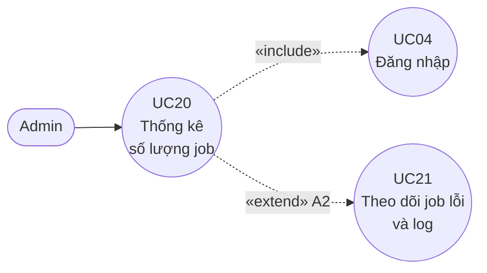

| Field | Content |
|---|---|
| **Use Case Number** | UC20 |
| **Use Case Name** | Xem thống kê số lượng job xử lý |
| **Actor(s)** | *Admin* |
| **Maturity** | Focused |
| **Summary** | *Admin* xem thống kê số lượng *job* thuyết minh theo trạng thái (`pending`, `processing`, `done`, `failed`), theo khoảng thời gian và theo ngôn ngữ đích để nắm mức độ sử dụng hệ thống. |

### Basic Course of Events

| Actor Action | System Response |
|---|---|
| 1. Use case bắt đầu khi Admin chọn "Thống kê job" trong trang quản trị. | |
| | 2. Hệ thống hiển thị bộ lọc khoảng thời gian (mặc định: 7 ngày gần nhất). |
| 3. Admin chọn khoảng thời gian (có thể giữ mặc định) và chọn "Xem thống kê". **A1** | |
| | 4. Hệ thống kiểm tra khoảng thời gian hợp lệ. **{Validate Date Range}** **E1** |
| | 5. Hệ thống tổng hợp dữ liệu từ `TranscriptionJob` và `JOB_TARGET_LANGUAGE`. **E2** |
| | 6. Hệ thống hiển thị: tổng số job, số job theo từng `status`, tỷ lệ thành công, số job theo từng ngôn ngữ đích và số job theo ngày (biểu đồ + bảng). |
| 7. Admin xem thống kê. **A2**   *Use case kết thúc.* | |

### Alternative Paths

**A1.** Không có job nào trong khoảng thời gian đã chọn. Hệ thống hiển thị thống kê bằng 0 kèm thông báo "Chưa có job trong khoảng thời gian này". Quay lại bước 3.

**A2.** Admin chọn xem danh sách job có `status = failed`. Thực hiện **{Theo dõi job lỗi và log hệ thống}** (UC21).

### Exception Paths

**E1.** Tại **{Validate Date Range}**, nếu ngày bắt đầu sau ngày kết thúc hoặc ngày ở tương lai, hệ thống báo lỗi và yêu cầu chọn lại. Quay lại bước 3.

**E2.** Nếu không tổng hợp được dữ liệu (lỗi cơ sở dữ liệu hoặc quá thời gian chờ), hệ thống hiển thị thông báo lỗi kèm nút "Thử lại". Quay lại bước 3.

### Other Fields

| Field | Content |
|---|---|
| **Extension Points** | **{Validate Date Range}** — Kiểm tra khoảng thời gian hợp lệ. **E1**   **{Theo dõi job lỗi và log hệ thống}** (A2) |
| **Triggers** | Admin muốn nắm tình hình sử dụng hệ thống theo ngày, tuần hoặc tháng. |
| **Assumptions** | Hệ thống đã lưu đủ dữ liệu job (`status`, `createdAt`, `completedAt`, ngôn ngữ). |
| **Preconditions** | Admin đã đăng nhập (UC04) với `role = admin`. |
| **Post Conditions** | Admin đã xem thống kê; không có dữ liệu nào bị thay đổi. |
| **Reference: Business Rules** | BR-20.1: Chỉ vai trò Admin mới được xem thống kê toàn hệ thống.  BR-20.2: Chỉ đếm job trong khoảng thời gian đã chọn, tính theo `createdAt`.  BR-20.3: Tỷ lệ thành công = số job `done` / số job đã kết thúc (`done` + `failed`). |
| **Author(s)** | Nhóm Đồ án |
| **Date** | 28-09-26 |

### Activity Diagram

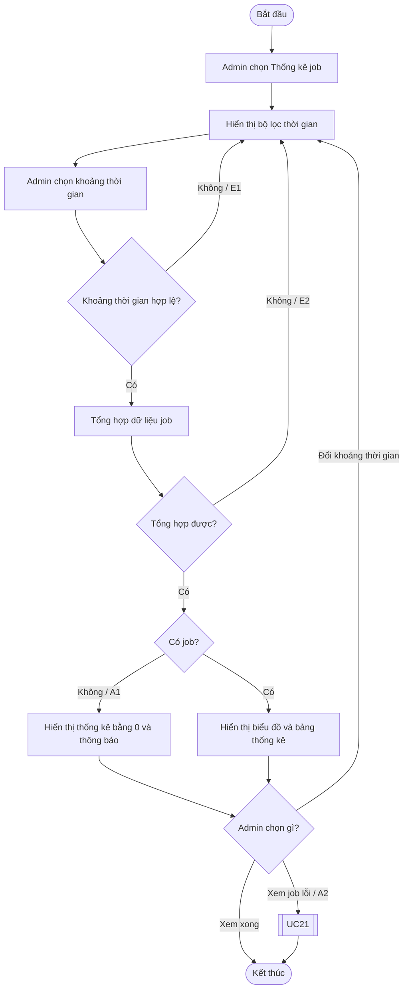

---

## UC21 — Theo dõi job lỗi và log hệ thống

### Use Case Diagram

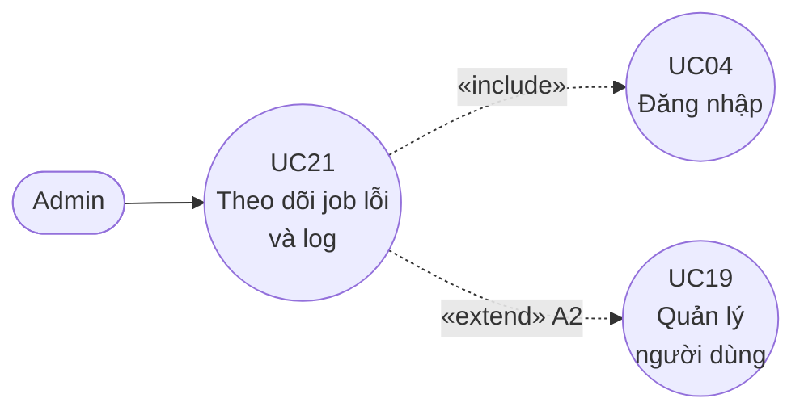

| Field | Content |
|---|---|
| **Use Case Number** | UC21 |
| **Use Case Name** | Theo dõi job lỗi (failed jobs) và log hệ thống |
| **Actor(s)** | *Admin* |
| **Maturity** | Focused |
| **Summary** | *Admin* xem danh sách các *job* có `status = failed`, xác định bước xử lý bị lỗi trong AI Pipeline (Speech-to-Text, dịch, Text-to-Speech, ghép audio) và đọc log hệ thống liên quan để phát hiện và điều tra lỗi. |

### Basic Course of Events

| Actor Action | System Response |
|---|---|
| 1. Use case bắt đầu khi Admin chọn "Job lỗi & Log" trong trang quản trị (hoặc từ UC20). | |
| | 2. Hệ thống tải và hiển thị danh sách job `failed` mới nhất (mã job, người dùng, ngôn ngữ nguồn/đích, thời điểm lỗi, bước lỗi), có phân trang. **E1** |
| 3. Admin lọc theo khoảng thời gian, bước lỗi hoặc ngôn ngữ (nếu cần). **A1** | |
| | 4. Hệ thống hiển thị danh sách theo điều kiện lọc. |
| 5. Admin chọn một job để xem chi tiết. **A2** | |
| | 6. Hệ thống hiển thị chi tiết job (`sourceFileUrl`, `sourceLanguage`, `targetLanguages`, `createdAt`, `status`) cùng thông báo lỗi và log của các bước xử lý liên quan. **E2** |
| 7. Admin xem thông tin lỗi và log. **A3**   *Use case kết thúc.* | |

### Alternative Paths

**A1.** Không có job lỗi nào khớp điều kiện lọc. Hệ thống hiển thị "Không có job lỗi". Quay lại bước 3.

**A2.** Admin chọn người dùng của job để xem tài khoản. Thực hiện **{Quản lý danh sách người dùng}** (UC19) với chi tiết người dùng đó.

**A3.** Admin chọn "Quay lại" để trở về danh sách job lỗi. Quay lại bước 4.

### Exception Paths

**E1.** Nếu không tải được danh sách job lỗi (lỗi cơ sở dữ liệu), hệ thống hiển thị thông báo lỗi kèm nút "Thử lại". Quay lại bước 2.

**E2.** Nếu không tải được log của job (log bị thiếu hoặc dịch vụ log không phản hồi), hệ thống vẫn hiển thị thông tin job, ghi chú "Không tải được log" và cho phép thử lại. Tiếp tục bước 7.

### Other Fields

| Field | Content |
|---|---|
| **Extension Points** | **{Quản lý danh sách người dùng}** (A2) |
| **Triggers** | 1. Admin nhận thấy tỷ lệ job thất bại tăng (từ UC20).  2. Người dùng báo lỗi kết quả xử lý (UC18).  3. Admin kiểm tra hệ thống định kỳ. |
| **Assumptions** | Hệ thống ghi nhận log cho từng bước của AI Pipeline (UC24–UC29). |
| **Preconditions** | Admin đã đăng nhập (UC04) với `role = admin`. |
| **Post Conditions** | Admin đã xem thông tin job lỗi và log; không có dữ liệu nào bị thay đổi. |
| **Reference: Business Rules** | BR-21.1: Chỉ vai trò Admin mới được xem log hệ thống.  BR-21.2: Danh sách mặc định sắp xếp theo thời điểm lỗi mới nhất.  BR-21.3: Log không được hiển thị mật khẩu hoặc `token` phiên làm việc. |
| **Author(s)** | Nhóm Đồ án |
| **Date** | 28-09-26 |

### Activity Diagram

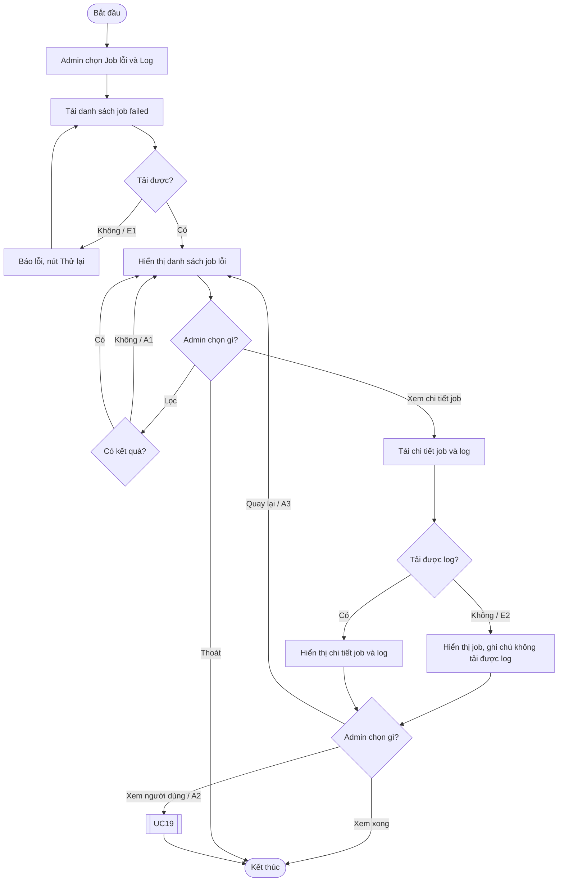

---

## UC22 — Quản lý danh sách ngôn ngữ hỗ trợ

### Use Case Diagram

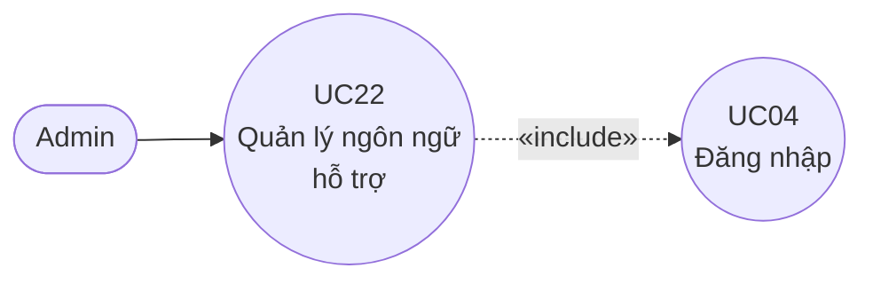

| Field | Content |
|---|---|
| **Use Case Number** | UC22 |
| **Use Case Name** | Quản lý danh sách ngôn ngữ hỗ trợ (thêm/xóa/sửa) |
| **Actor(s)** | *Admin* |
| **Maturity** | Focused |
| **Summary** | *Admin* thêm, sửa hoặc xóa các *ngôn ngữ* mà hệ thống hỗ trợ. Danh sách này quyết định các ngôn ngữ nguồn và đích mà *User* có thể chọn khi tạo job và được hiển thị trên trang giới thiệu. |

### Basic Course of Events

| Actor Action | System Response |
|---|---|
| 1. Use case bắt đầu khi Admin chọn "Quản lý ngôn ngữ" trong trang quản trị. | |
| | 2. Hệ thống tải và hiển thị danh sách ngôn ngữ (`code`, `name`, `isSupported`). **E1** |
| 3. Admin chọn "Thêm ngôn ngữ". **A1, A2** | |
| | 4. Hệ thống hiển thị form gồm: mã ngôn ngữ (`code`), tên (`name`), trạng thái hỗ trợ (`isSupported`). |
| 5. Admin nhập thông tin và chọn "Lưu". **A3** | |
| | 6. Hệ thống kiểm tra dữ liệu nhập vào. **{Validate Language Data}** **E2, E3** |
| | 7. Hệ thống lưu ngôn ngữ mới vào bảng `LANGUAGE`. **E4** |
| | 8. Hệ thống thông báo thành công và làm mới danh sách.   *Use case kết thúc.* |

### Alternative Paths

**A1.** Admin chọn "Sửa" trên một ngôn ngữ. Hệ thống hiển thị form với dữ liệu hiện có (không cho sửa `code`). Admin chỉnh `name` hoặc `isSupported` rồi lưu. Quay lại bước 6.

**A2.** Admin chọn "Xóa" trên một ngôn ngữ. Hệ thống kiểm tra ngôn ngữ đó **{Validate Language Removal}**, yêu cầu xác nhận, sau đó thực hiện theo BR-22.3. **E5** Quay lại bước 8.

**A3.** Admin chọn "Hủy" ở form. Hệ thống bỏ dữ liệu đã nhập và quay lại bước 2.

### Exception Paths

**E1.** Nếu không tải được danh sách ngôn ngữ (lỗi cơ sở dữ liệu), hệ thống hiển thị thông báo lỗi kèm nút "Thử lại". Quay lại bước 2.

**E2.** Tại **{Validate Language Data}**, nếu `code` hoặc `name` bỏ trống hoặc `code` sai định dạng (BR-22.2), hệ thống đánh dấu trường lỗi. Quay lại bước 4.

**E3.** Nếu `code` đã tồn tại, hệ thống thông báo trùng mã. Quay lại bước 4.

**E4.** Nếu không lưu được (lỗi cơ sở dữ liệu), hệ thống thông báo lỗi, không thay đổi dữ liệu và cho Admin thử lại. Quay lại bước 4.

**E5.** Nếu ngôn ngữ đang được job đang xử lý (`pending`, `processing`) sử dụng, hệ thống từ chối thao tác xóa và nêu lý do. Quay lại bước 2.

### Other Fields

| Field | Content |
|---|---|
| **Extension Points** | **{Validate Language Data}** — Kiểm tra bắt buộc, định dạng và tính duy nhất của `code`. (Xem BR-22.2) **E2, E3**   **{Validate Language Removal}** — Kiểm tra ngôn ngữ có đang được job đang xử lý sử dụng hay không. (Xem BR-22.3) **E5** |
| **Triggers** | Admin muốn mở rộng, điều chỉnh hoặc ngừng hỗ trợ một ngôn ngữ. |
| **Assumptions** | Dịch vụ Speech-to-Text, dịch và Text-to-Speech đã có khả năng xử lý ngôn ngữ mà Admin thêm. |
| **Preconditions** | Admin đã đăng nhập (UC04) với `role = admin`. |
| **Post Conditions** | Bảng `LANGUAGE` được cập nhật; danh sách ngôn ngữ mà User chọn khi tạo job (UC09, UC10) và trang giới thiệu (UC01) phản ánh thay đổi. |
| **Reference: Business Rules** | BR-22.1: Chỉ vai trò Admin mới được thay đổi danh sách ngôn ngữ.  BR-22.2: `code` là duy nhất, không đổi sau khi tạo (ví dụ `vi`, `en`, `ja`).  BR-22.3: "Xóa" ngôn ngữ đã từng được job sử dụng chỉ đặt `isSupported = false` để giữ nguyên lịch sử; chỉ xóa hẳn bản ghi khi chưa có job nào tham chiếu.  BR-22.4: Chỉ ngôn ngữ có `isSupported = true` được hiển thị và cho phép chọn. |
| **Author(s)** | Nhóm Đồ án |
| **Date** | 28-09-26 |

### Activity Diagram

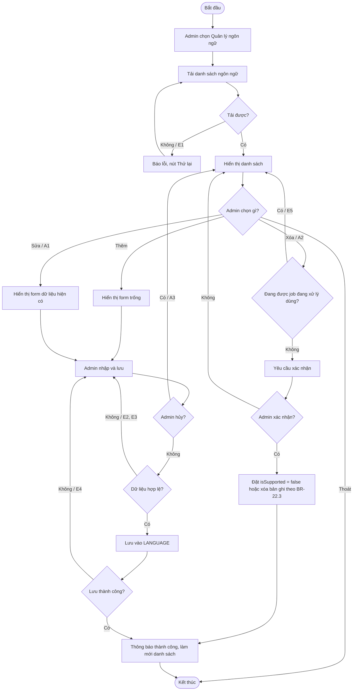

---

## UC23 — Xem báo cáo hiệu suất hệ thống

### Use Case Diagram

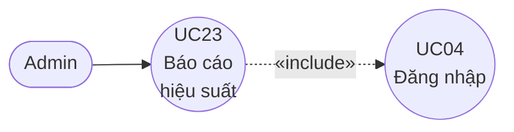

| Field | Content |
|---|---|
| **Use Case Number** | UC23 |
| **Use Case Name** | Xem báo cáo hiệu suất hệ thống |
| **Actor(s)** | *Admin* |
| **Maturity** | Focused |
| **Summary** | *Admin* xem báo cáo hiệu suất xử lý của hệ thống như thời gian xử lý trung bình của job, thời gian chờ trong hàng đợi và tỷ lệ thành công theo từng khoảng thời gian, để đánh giá chất lượng vận hành và phát hiện điểm nghẽn. |

### Basic Course of Events

| Actor Action | System Response |
|---|---|
| 1. Use case bắt đầu khi Admin chọn "Báo cáo hiệu suất" trong trang quản trị. | |
| | 2. Hệ thống hiển thị bộ lọc khoảng thời gian (mặc định: 7 ngày gần nhất) và tùy chọn lọc theo ngôn ngữ đích. |
| 3. Admin chọn khoảng thời gian và (tùy chọn) ngôn ngữ đích, sau đó chọn "Xem báo cáo". **A1** | |
| | 4. Hệ thống kiểm tra khoảng thời gian hợp lệ. **{Validate Date Range}** **E1** |
| | 5. Hệ thống tính các chỉ số từ các job đã kết thúc (`done`, `failed`). **E2** |
| | 6. Hệ thống hiển thị báo cáo gồm: thời gian xử lý trung bình (`completedAt` − `createdAt`), thời gian xử lý lớn nhất/nhỏ nhất, tỷ lệ thành công, số job theo từng khung giờ và so sánh với kỳ trước. |
| 7. Admin xem báo cáo. **A2**   *Use case kết thúc.* | |

### Alternative Paths

**A1.** Không có job đã kết thúc trong khoảng thời gian đã chọn. Hệ thống hiển thị "Chưa đủ dữ liệu để lập báo cáo". Quay lại bước 3.

**A2.** Admin chọn "Xuất báo cáo" (CSV). Hệ thống tạo tệp báo cáo theo bộ lọc hiện tại và cho Admin tải xuống. **E3** Quay lại bước 7.

### Exception Paths

**E1.** Tại **{Validate Date Range}**, nếu ngày bắt đầu sau ngày kết thúc hoặc ngày ở tương lai, hệ thống báo lỗi và yêu cầu chọn lại. Quay lại bước 3.

**E2.** Nếu không tính được báo cáo (lỗi cơ sở dữ liệu hoặc quá thời gian chờ), hệ thống hiển thị thông báo lỗi kèm nút "Thử lại". Quay lại bước 3.

**E3.** Nếu không tạo được tệp xuất, hệ thống thông báo lỗi và vẫn giữ nguyên báo cáo đang hiển thị. Quay lại bước 7.

### Other Fields

| Field | Content |
|---|---|
| **Extension Points** | **{Validate Date Range}** — Kiểm tra khoảng thời gian hợp lệ. **E1** |
| **Triggers** | Admin muốn đánh giá hiệu năng hệ thống sau khi có nhiều người dùng hoặc sau khi thay đổi cấu hình. |
| **Assumptions** | Mỗi job lưu đủ `createdAt` và `completedAt`. |
| **Preconditions** | Admin đã đăng nhập (UC04) với `role = admin`. |
| **Post Conditions** | Admin đã xem báo cáo (và có thể đã tải tệp xuất); không có dữ liệu hệ thống nào bị thay đổi. |
| **Reference: Business Rules** | BR-23.1: Chỉ vai trò Admin mới được xem báo cáo hiệu suất.  BR-23.2: Thời gian xử lý của một job = `completedAt` − `createdAt`.  BR-23.3: Job bị hủy bởi người dùng (UC17) không tính vào thời gian xử lý trung bình. |
| **Author(s)** | Nhóm Đồ án |
| **Date** | 28-09-26 |

### Activity Diagram

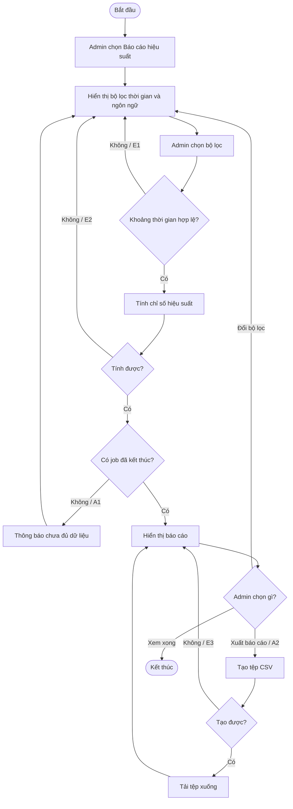
