# Thuyết minh tự động đa ngôn ngữ — Focused Use Cases (Actor: System)

**Version 1.0**

> Theo mẫu `FocusedusecasesGuest.md` / `FocusedUseCasesAdmin.md` và danh sách Use Case trong PRD (mục 6, Actor: System — AI Pipeline nội bộ; mục 10.3 Luồng xử lý chi tiết). Nhãn trường giữ tiếng Anh như mẫu, nội dung tiếng Việt.

## Revision History

| Date     | Version | Description                                                                  | Author     |
|----------|---------|------------------------------------------------------------------------------|------------|
| 28-09-26 | 1.0     | Bản đầu: UC24–UC30, Use Case Diagram, Activity Diagrams (System)             | Nhóm Đồ án |

## Table of Contents

| Mã   | Use Case                            |
|------|-------------------------------------|
| [UC24](#uc24--trích-xuất-audio-từ-video-upload) | Trích xuất audio từ video upload |
| [UC25](#uc25--chuyển-giọng-nói-thành-văn-bản-speech-to-text) | Chuyển giọng nói thành văn bản (Speech-to-Text) |
| [UC26](#uc26--dịch-văn-bản-sang-ngôn-ngữ-đích) | Dịch văn bản sang ngôn ngữ đích (Machine Translation) |
| [UC27](#uc27--chuyển-văn-bản-thành-giọng-nói-text-to-speech) | Chuyển văn bản thành giọng nói (Text-to-Speech) |
| [UC28](#uc28--ghép-audio-thuyết-minh-vào-video-gốc) | Ghép audio thuyết minh vào video gốc |
| [UC29](#uc29--lưu-file-kết-quả-vào-storage) | Lưu file kết quả vào storage |
| [UC30](#uc30--gửi-thông-báo-hoàn-tất-cho-user) | Gửi thông báo hoàn tất cho User |

## Quy ước chung của AI Pipeline

- **Actor System** là các thành phần nội bộ (Worker, Speech-to-Text Service, Translation Service, Text-to-Speech Service) chạy tự động, không có người thao tác.
- Use case bắt đầu khi *User* gửi yêu cầu xử lý (UC11) và Worker lấy được job từ Job Queue; các UC24–UC30 chạy tuần tự theo mục 10.3 của PRD.
- Nếu bất kỳ bước nào lỗi không khắc phục được, `TranscriptionJob.status` chuyển sang `failed` (theo PRD, bước [8]); các bước sau không chạy.
- Trước mỗi bước, Worker kiểm tra job chưa bị *User* hủy (UC17). Nếu đã hủy, pipeline dừng và dọn dữ liệu tạm.
- Với nhiều ngôn ngữ đích, UC26–UC28 được lặp lại cho từng ngôn ngữ trong `targetLanguages`.

## Use Case Diagram tổng quan (System)

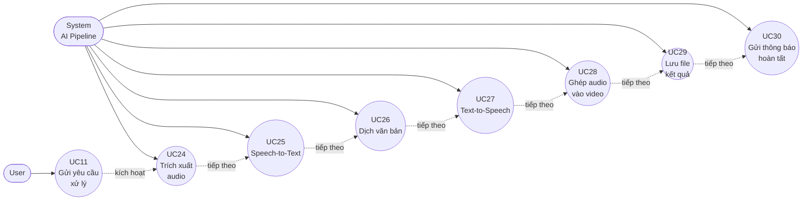

---

## UC24 — Trích xuất audio từ video upload

### Use Case Diagram

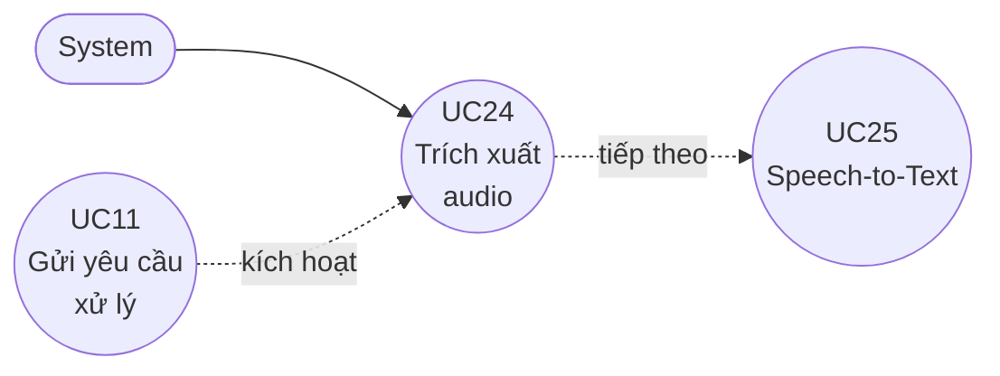

| Field | Content |
|---|---|
| **Use Case Number** | UC24 |
| **Use Case Name** | Trích xuất audio từ video upload |
| **Actor(s)** | *System* (Worker) |
| **Maturity** | Focused |
| **Summary** | *System* lấy job từ hàng đợi, tách luồng âm thanh ra khỏi file video mà *User* đã upload để làm đầu vào cho bước Speech-to-Text. |

### Basic Course of Events

| Actor Action | System Response |
|---|---|
| 1. Use case bắt đầu khi Worker lấy một job `pending` từ Job Queue. **A1** | |
| | 2. Hệ thống cập nhật `status` của job sang `processing`. **E1** |
| | 3. Hệ thống tải file gốc từ `sourceFileUrl` trong Storage. **E2** |
| | 4. Hệ thống kiểm tra định dạng file. **{Validate Source File}** **E3** |
| | 5. Hệ thống tách audio từ video và chuẩn hóa về định dạng đầu vào của dịch vụ Speech-to-Text. **E4** |
| | 6. Hệ thống lưu audio tạm và chuyển sang **{Chuyển giọng nói thành văn bản}** (UC25).   *Use case kết thúc.* |

### Alternative Paths

**A1.** Nếu file upload đã là audio (không phải video), hệ thống bỏ qua bước 5, dùng trực tiếp file gốc làm audio đầu vào và chuyển sang bước 6.

### Exception Paths

**E1.** Nếu không cập nhật được trạng thái job (lỗi cơ sở dữ liệu), hệ thống trả job về hàng đợi để thử lại. Use case kết thúc.

**E2.** Nếu không tải được file gốc (file mất hoặc lỗi Storage), hệ thống thử lại theo BR-24.3; nếu vẫn lỗi, hệ thống đặt `status = failed` kèm lý do. Use case kết thúc.

**E3.** Tại **{Validate Source File}**, nếu file hỏng hoặc không phải video/audio hợp lệ, hệ thống đặt `status = failed` kèm lý do "File không hợp lệ". Use case kết thúc.

**E4.** Nếu video không có luồng âm thanh hoặc việc tách audio thất bại, hệ thống đặt `status = failed` kèm lý do tương ứng. Use case kết thúc.

### Other Fields

| Field | Content |
|---|---|
| **Extension Points** | **{Validate Source File}** — Kiểm tra file tải về có mở được và có luồng âm thanh hay không. **E3, E4** |
| **Triggers** | *User* gửi yêu cầu xử lý (UC11) và job được đưa vào Job Queue với `status = pending`. |
| **Assumptions** | File gốc đã được lưu trong Storage khi User upload (UC08). |
| **Preconditions** | Tồn tại một `TranscriptionJob` có `status = pending`, chưa bị hủy. |
| **Post Conditions** | Job có `status = processing`; audio đầu vào sẵn sàng cho UC25. Nếu lỗi: `status = failed`. |
| **Reference: Business Rules** | BR-24.1: Job phải được lấy từ Job Queue, mỗi job chỉ do một Worker xử lý tại một thời điểm.  BR-24.2: Job bị hủy (UC17) không được xử lý.  BR-24.3: Lỗi tạm thời (mạng, Storage) được thử lại tối đa 3 lần trước khi đặt `failed`. |
| **Author(s)** | Nhóm Đồ án |
| **Date** | 28-09-26 |

### Activity Diagram

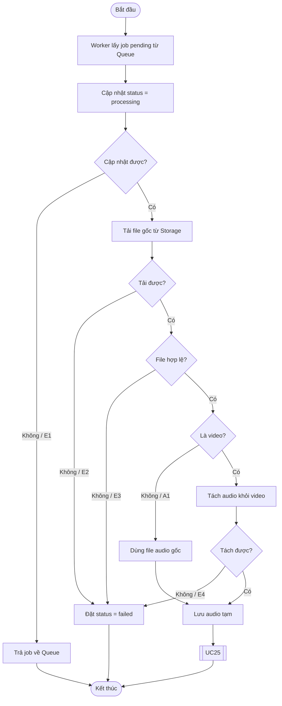

---

## UC25 — Chuyển giọng nói thành văn bản (Speech-to-Text)

### Use Case Diagram

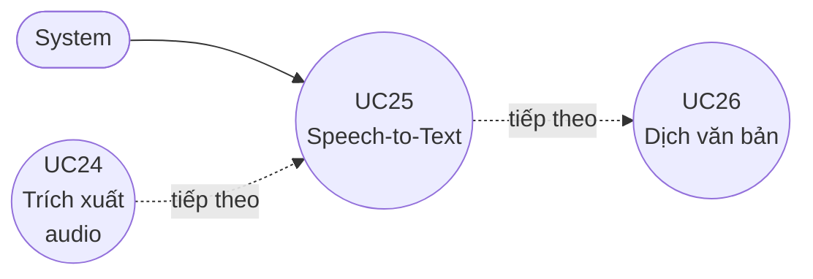

| Field | Content |
|---|---|
| **Use Case Number** | UC25 |
| **Use Case Name** | Chuyển giọng nói thành văn bản (Speech-to-Text) |
| **Actor(s)** | *System* (Worker, Speech-to-Text Service) |
| **Maturity** | Focused |
| **Summary** | *System* chuyển audio đầu vào thành văn bản gốc (transcript) theo *ngôn ngữ nguồn* mà *User* đã chọn, kèm mốc thời gian của từng đoạn để phục vụ việc ghép thuyết minh. |

### Basic Course of Events

| Actor Action | System Response |
|---|---|
| 1. Use case bắt đầu khi UC24 hoàn tất và có audio đầu vào. | |
| | 2. Hệ thống kiểm tra job chưa bị hủy. **A1** |
| | 3. Hệ thống gửi audio và `sourceLanguage` tới Speech-to-Text Service. **E1** |
| | 4. Speech-to-Text Service trả về văn bản gốc chia theo đoạn, kèm mốc thời gian bắt đầu/kết thúc. **E2** |
| | 5. Hệ thống kiểm tra kết quả có nội dung. **{Validate Transcript}** **E3** |
| | 6. Hệ thống lưu transcript vào cơ sở dữ liệu (liên kết với job). **E4** |
| | 7. Hệ thống chuyển sang **{Dịch văn bản sang ngôn ngữ đích}** (UC26).   *Use case kết thúc.* |

### Alternative Paths

**A1.** Nếu job đã bị *User* hủy (UC17), hệ thống dừng pipeline, xóa dữ liệu tạm và kết thúc; `status` do UC17 quyết định.

### Exception Paths

**E1.** Nếu Speech-to-Text Service không phản hồi hoặc trả lỗi tạm thời, hệ thống thử lại theo BR-25.3; nếu vẫn lỗi, hệ thống đặt `status = failed`. Use case kết thúc.

**E2.** Nếu dịch vụ không hỗ trợ `sourceLanguage` hoặc không nhận dạng được giọng nói, hệ thống đặt `status = failed` kèm lý do. Use case kết thúc.

**E3.** Tại **{Validate Transcript}**, nếu transcript rỗng (audio im lặng hoặc không có lời nói), hệ thống đặt `status = failed` kèm lý do "Không phát hiện giọng nói". Use case kết thúc.

**E4.** Nếu không lưu được transcript (lỗi cơ sở dữ liệu), hệ thống thử lại theo BR-25.3; nếu vẫn lỗi, hệ thống đặt `status = failed`. Use case kết thúc.

### Other Fields

| Field | Content |
|---|---|
| **Extension Points** | **{Validate Transcript}** — Kiểm tra transcript không rỗng và có mốc thời gian. **E3** |
| **Triggers** | UC24 hoàn tất thành công. |
| **Assumptions** | `sourceLanguage` là ngôn ngữ có `isSupported = true` và đúng với ngôn ngữ trong audio. |
| **Preconditions** | Job có `status = processing`; audio đầu vào đã sẵn sàng. |
| **Post Conditions** | Transcript của job được lưu trong cơ sở dữ liệu. Nếu lỗi: `status = failed`. |
| **Reference: Business Rules** | BR-25.1: Nhận dạng theo đúng `sourceLanguage` do User chọn, không tự đoán ngôn ngữ.  BR-25.2: Transcript phải giữ mốc thời gian của từng đoạn.  BR-25.3: Lỗi tạm thời được thử lại tối đa 3 lần trước khi đặt `failed`. |
| **Author(s)** | Nhóm Đồ án |
| **Date** | 28-09-26 |

### Activity Diagram

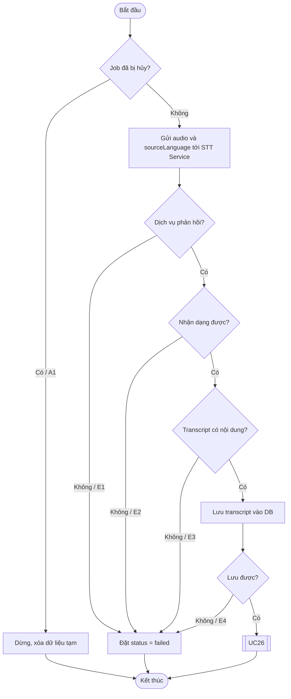

---

## UC26 — Dịch văn bản sang ngôn ngữ đích

### Use Case Diagram

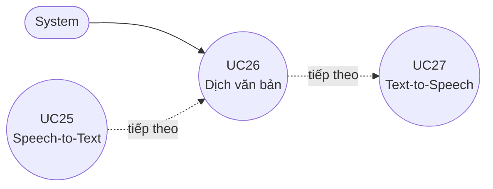

| Field | Content |
|---|---|
| **Use Case Number** | UC26 |
| **Use Case Name** | Dịch văn bản sang ngôn ngữ đích (Machine Translation) |
| **Actor(s)** | *System* (Worker, Translation Service) |
| **Maturity** | Focused |
| **Summary** | *System* dịch transcript gốc sang từng *ngôn ngữ đích* trong `targetLanguages` của job và lưu bản dịch, giữ nguyên mốc thời gian của từng đoạn. |

### Basic Course of Events

| Actor Action | System Response |
|---|---|
| 1. Use case bắt đầu khi UC25 hoàn tất và có transcript. | |
| | 2. Hệ thống lấy danh sách `targetLanguages` của job. |
| | 3. Với mỗi ngôn ngữ đích, hệ thống kiểm tra job chưa bị hủy. **A1** |
| | 4. Hệ thống gửi transcript, `sourceLanguage` và ngôn ngữ đích tới Translation Service. **E1** |
| | 5. Translation Service trả về văn bản đã dịch theo từng đoạn. **E2** |
| | 6. Hệ thống kiểm tra bản dịch. **{Validate Translation}** **E3** |
| | 7. Hệ thống lưu bản dịch vào bản ghi `JOB_TARGET_LANGUAGE` tương ứng. **E4** |
| | 8. Hệ thống lặp lại bước 3–7 cho đến khi dịch xong mọi ngôn ngữ đích, sau đó chuyển sang **{Chuyển văn bản thành giọng nói}** (UC27). **A2**   *Use case kết thúc.* |

### Alternative Paths

**A1.** Nếu job đã bị *User* hủy (UC17), hệ thống dừng pipeline, xóa dữ liệu tạm và kết thúc.

**A2.** Nếu ngôn ngữ đích trùng với `sourceLanguage`, hệ thống bỏ qua dịch và dùng nguyên transcript gốc làm bản dịch cho ngôn ngữ đó. Tiếp tục bước 7.

### Exception Paths

**E1.** Nếu Translation Service không phản hồi hoặc lỗi tạm thời, hệ thống thử lại theo BR-26.3; nếu vẫn lỗi, hệ thống đặt `status = failed` (BR-26.2). Use case kết thúc.

**E2.** Nếu dịch vụ không hỗ trợ cặp ngôn ngữ nguồn–đích, hệ thống đặt `status = failed` kèm lý do. Use case kết thúc.

**E3.** Tại **{Validate Translation}**, nếu bản dịch rỗng hoặc số đoạn không khớp transcript gốc, hệ thống coi là lỗi dịch và xử lý như E1. 

**E4.** Nếu không lưu được bản dịch (lỗi cơ sở dữ liệu), hệ thống thử lại theo BR-26.3; nếu vẫn lỗi, hệ thống đặt `status = failed`. Use case kết thúc.

### Other Fields

| Field | Content |
|---|---|
| **Extension Points** | **{Validate Translation}** — Kiểm tra bản dịch không rỗng và số đoạn khớp với transcript gốc. **E3** |
| **Triggers** | UC25 hoàn tất thành công. |
| **Assumptions** | Mọi ngôn ngữ trong `targetLanguages` có `isSupported = true` tại thời điểm User gửi job. |
| **Preconditions** | Job có `status = processing`; transcript đã được lưu. |
| **Post Conditions** | Mỗi ngôn ngữ đích có bản dịch được lưu trong `JOB_TARGET_LANGUAGE`. Nếu lỗi: `status = failed`. |
| **Reference: Business Rules** | BR-26.1: Bản dịch phải giữ đúng số đoạn và mốc thời gian của transcript gốc.  BR-26.2: Theo PRD, lỗi ở bất kỳ ngôn ngữ đích nào làm job chuyển sang `failed`.  BR-26.3: Lỗi tạm thời được thử lại tối đa 3 lần trước khi đặt `failed`. |
| **Author(s)** | Nhóm Đồ án |
| **Date** | 28-09-26 |

### Activity Diagram

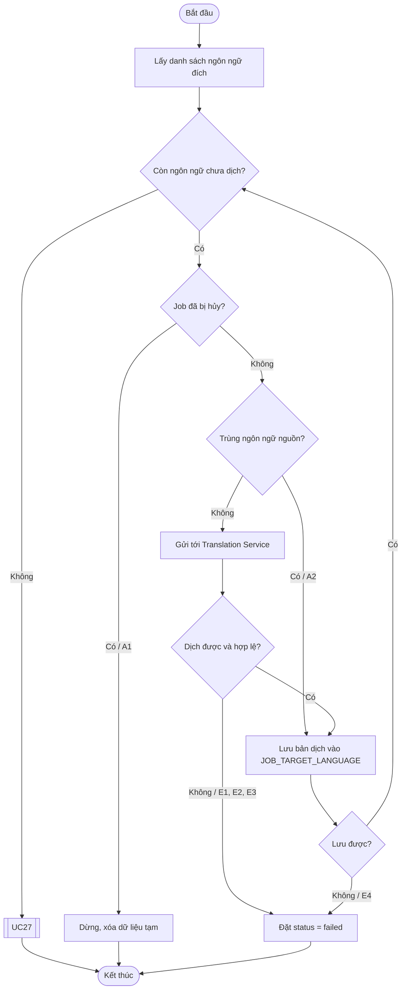

---

## UC27 — Chuyển văn bản thành giọng nói (Text-to-Speech)

### Use Case Diagram

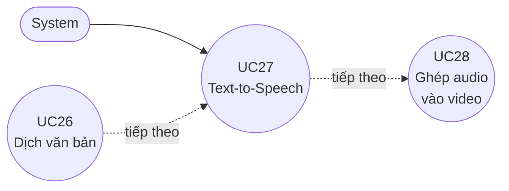

| Field | Content |
|---|---|
| **Use Case Number** | UC27 |
| **Use Case Name** | Chuyển văn bản thành giọng nói (Text-to-Speech) |
| **Actor(s)** | *System* (Worker, Text-to-Speech Service) |
| **Maturity** | Focused |
| **Summary** | *System* chuyển văn bản đã dịch của từng *ngôn ngữ đích* thành audio thuyết minh, điều chỉnh độ dài sao cho khớp mốc thời gian của video gốc. |

### Basic Course of Events

| Actor Action | System Response |
|---|---|
| 1. Use case bắt đầu khi UC26 hoàn tất và mọi ngôn ngữ đích đã có bản dịch. | |
| | 2. Với mỗi ngôn ngữ đích, hệ thống kiểm tra job chưa bị hủy. **A1** |
| | 3. Hệ thống chọn giọng đọc phù hợp với ngôn ngữ đích (theo vai trò tài khoản: giọng chuẩn hoặc chất lượng cao). **A2** |
| | 4. Hệ thống gửi bản dịch tới Text-to-Speech Service để tạo audio theo từng đoạn. **E1** |
| | 5. Text-to-Speech Service trả về audio thuyết minh. **E2** |
| | 6. Hệ thống căn chỉnh audio theo mốc thời gian của các đoạn. **{Align Audio Timing}** **E3** |
| | 7. Hệ thống lưu file audio thuyết minh (tạm) cho ngôn ngữ đó. **E4** |
| | 8. Hệ thống lặp lại bước 2–7 cho đến khi xong mọi ngôn ngữ đích, sau đó chuyển sang **{Ghép audio thuyết minh vào video gốc}** (UC28).   *Use case kết thúc.* |

### Alternative Paths

**A1.** Nếu job đã bị *User* hủy (UC17), hệ thống dừng pipeline, xóa dữ liệu tạm và kết thúc.

**A2.** Nếu tài khoản là *Premium User*, hệ thống dùng giọng đọc AI chất lượng cao (theo PRD, mục 2). Tiếp tục bước 4.

### Exception Paths

**E1.** Nếu Text-to-Speech Service không phản hồi hoặc lỗi tạm thời, hệ thống thử lại theo BR-27.3; nếu vẫn lỗi, hệ thống đặt `status = failed`. Use case kết thúc.

**E2.** Nếu dịch vụ không có giọng đọc cho ngôn ngữ đích, hệ thống đặt `status = failed` kèm lý do. Use case kết thúc.

**E3.** Tại **{Align Audio Timing}**, nếu audio quá dài so với khoảng thời gian cho phép, hệ thống điều chỉnh tốc độ đọc trong giới hạn BR-27.2; nếu vẫn không khớp, hệ thống chấp nhận độ lệch nhỏ nhất và ghi log cảnh báo. Tiếp tục bước 7.

**E4.** Nếu không lưu được file audio (lỗi Storage), hệ thống thử lại theo BR-27.3; nếu vẫn lỗi, hệ thống đặt `status = failed`. Use case kết thúc.

### Other Fields

| Field | Content |
|---|---|
| **Extension Points** | **{Align Audio Timing}** — Điều chỉnh độ dài/tốc độ audio để khớp mốc thời gian của video gốc. (Xem BR-27.2) **E3** |
| **Triggers** | UC26 hoàn tất thành công. |
| **Assumptions** | Text-to-Speech Service có giọng đọc cho mọi ngôn ngữ có `isSupported = true`. |
| **Preconditions** | Job có `status = processing`; mọi ngôn ngữ đích đã có bản dịch. |
| **Post Conditions** | Mỗi ngôn ngữ đích có file audio thuyết minh (tạm). Nếu lỗi: `status = failed`. |
| **Reference: Business Rules** | BR-27.1: Mỗi ngôn ngữ đích tạo một file audio riêng.  BR-27.2: Tốc độ đọc chỉ được điều chỉnh trong giới hạn cho phép để giọng còn tự nhiên.  BR-27.3: Lỗi tạm thời được thử lại tối đa 3 lần trước khi đặt `failed`.  BR-27.4: Chất lượng giọng đọc phụ thuộc vai trò tài khoản (User / Premium User). |
| **Author(s)** | Nhóm Đồ án |
| **Date** | 28-09-26 |

### Activity Diagram

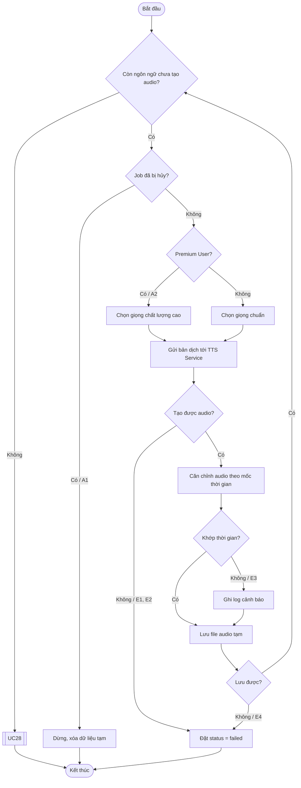

---

## UC28 — Ghép audio thuyết minh vào video gốc

### Use Case Diagram

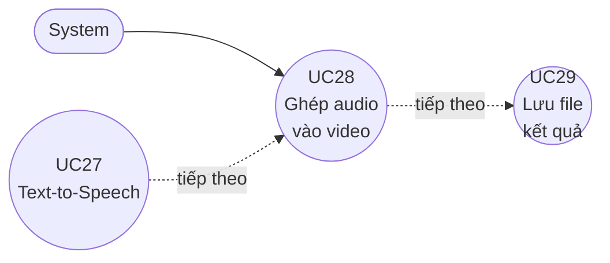

| Field | Content |
|---|---|
| **Use Case Number** | UC28 |
| **Use Case Name** | Ghép audio thuyết minh vào video gốc |
| **Actor(s)** | *System* (Worker) |
| **Maturity** | Focused |
| **Summary** | *System* ghép audio thuyết minh của từng *ngôn ngữ đích* vào video gốc để tạo video hoàn chỉnh có thuyết minh. Bước này chỉ chạy khi cần xuất video. |

### Basic Course of Events

| Actor Action | System Response |
|---|---|
| 1. Use case bắt đầu khi UC27 hoàn tất và mọi ngôn ngữ đích đã có audio thuyết minh. | |
| | 2. Hệ thống kiểm tra đầu vào là video. **A1** |
| | 3. Hệ thống kiểm tra job chưa bị hủy. **A2** |
| | 4. Với mỗi ngôn ngữ đích, hệ thống tải video gốc và audio thuyết minh tương ứng. **E1** |
| | 5. Hệ thống ghép audio thuyết minh vào video, giảm hoặc thay âm thanh gốc theo cấu hình mặc định. **E2** |
| | 6. Hệ thống kiểm tra video đầu ra mở được và có độ dài khớp video gốc. **{Validate Output Video}** **E3** |
| | 7. Hệ thống lưu video kết quả tạm và chuyển sang **{Lưu file kết quả vào storage}** (UC29).   *Use case kết thúc.* |

### Alternative Paths

**A1.** Nếu đầu vào chỉ là audio (không có video), hệ thống bỏ qua ghép, dùng chính file audio thuyết minh làm kết quả và chuyển sang UC29.

**A2.** Nếu job đã bị *User* hủy (UC17), hệ thống dừng pipeline, xóa dữ liệu tạm và kết thúc.

### Exception Paths

**E1.** Nếu không tải được video gốc hoặc audio thuyết minh, hệ thống thử lại theo BR-28.3; nếu vẫn lỗi, hệ thống đặt `status = failed`. Use case kết thúc.

**E2.** Nếu quá trình ghép thất bại (lỗi mã hóa hoặc không đủ tài nguyên), hệ thống thử lại theo BR-28.3; nếu vẫn lỗi, hệ thống đặt `status = failed`. Use case kết thúc.

**E3.** Tại **{Validate Output Video}**, nếu video đầu ra hỏng hoặc lệch độ dài quá mức cho phép, hệ thống coi là lỗi ghép và xử lý như E2.

### Other Fields

| Field | Content |
|---|---|
| **Extension Points** | **{Validate Output Video}** — Kiểm tra video đầu ra mở được và độ dài khớp video gốc. **E3** |
| **Triggers** | UC27 hoàn tất thành công. |
| **Assumptions** | Video gốc vẫn còn trong Storage tại `sourceFileUrl`. |
| **Preconditions** | Job có `status = processing`; audio thuyết minh của mọi ngôn ngữ đích đã sẵn sàng. |
| **Post Conditions** | Mỗi ngôn ngữ đích có một video (hoặc audio, nếu đầu vào là audio) kết quả tạm. Nếu lỗi: `status = failed`. |
| **Reference: Business Rules** | BR-28.1: Mỗi ngôn ngữ đích tạo một file video kết quả riêng.  BR-28.2: Không được ghi đè hay làm thay đổi file video gốc.  BR-28.3: Lỗi tạm thời được thử lại tối đa 3 lần trước khi đặt `failed`. |
| **Author(s)** | Nhóm Đồ án |
| **Date** | 28-09-26 |

### Activity Diagram

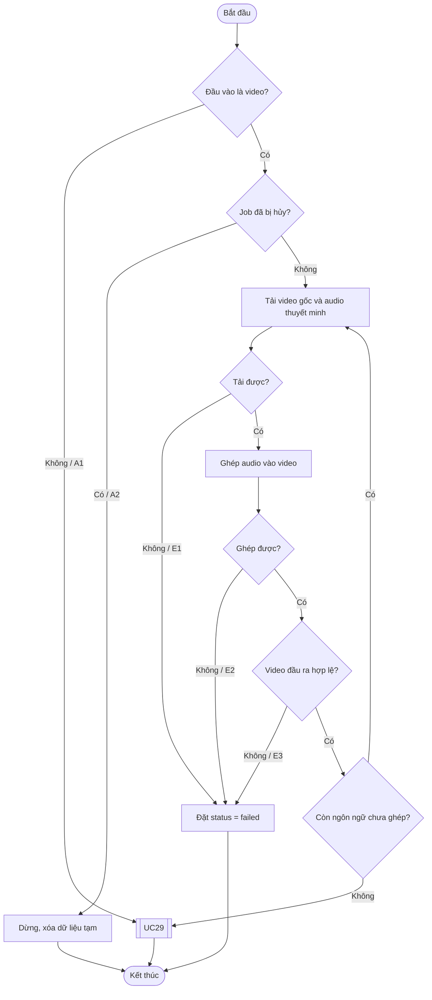

---

## UC29 — Lưu file kết quả vào storage

### Use Case Diagram

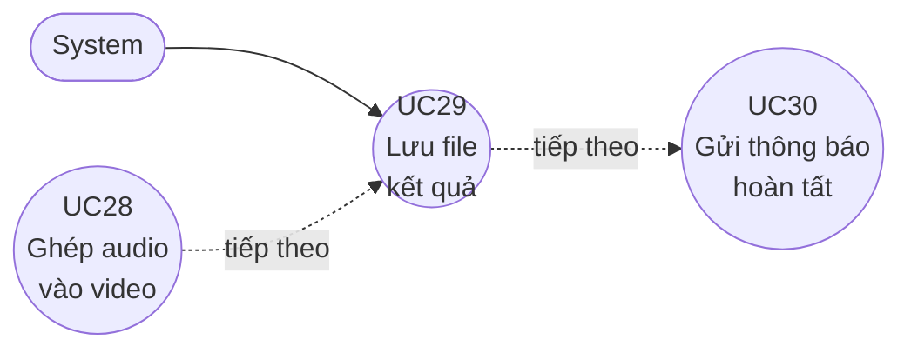

| Field | Content |
|---|---|
| **Use Case Number** | UC29 |
| **Use Case Name** | Lưu file kết quả vào storage |
| **Actor(s)** | *System* (Worker) |
| **Maturity** | Focused |
| **Summary** | *System* tải file kết quả của từng *ngôn ngữ đích* lên Storage lâu dài, lưu đường dẫn `resultFileUrl` vào cơ sở dữ liệu và cập nhật job sang trạng thái hoàn tất. |

### Basic Course of Events

| Actor Action | System Response |
|---|---|
| 1. Use case bắt đầu khi UC28 hoàn tất (hoặc audio thuyết minh sẵn sàng nếu đầu vào là audio). | |
| | 2. Hệ thống kiểm tra job chưa bị hủy. **A1** |
| | 3. Với mỗi ngôn ngữ đích, hệ thống tải file kết quả lên Storage. **E1** |
| | 4. Hệ thống kiểm tra file đã lưu (kích thước và đọc lại được). **{Verify Stored File}** **E2** |
| | 5. Hệ thống lưu `resultFileUrl` vào bản ghi `JOB_TARGET_LANGUAGE` tương ứng. **E3** |
| | 6. Hệ thống xóa các file tạm (audio trích xuất, audio thuyết minh tạm, video tạm). |
| | 7. Hệ thống cập nhật `status = done` và `completedAt` của job. **E3** |
| | 8. Hệ thống chuyển sang **{Gửi thông báo hoàn tất cho User}** (UC30).   *Use case kết thúc.* |

### Alternative Paths

**A1.** Nếu job đã bị *User* hủy (UC17), hệ thống không lưu kết quả, xóa dữ liệu tạm và kết thúc.

### Exception Paths

**E1.** Nếu không tải được file lên Storage (lỗi mạng hoặc hết dung lượng), hệ thống thử lại theo BR-29.3; nếu vẫn lỗi, hệ thống đặt `status = failed`. Use case kết thúc.

**E2.** Tại **{Verify Stored File}**, nếu file lưu bị thiếu hoặc hỏng, hệ thống xóa file đó và xử lý như E1.

**E3.** Nếu không cập nhật được cơ sở dữ liệu (`resultFileUrl`, `status`), hệ thống thử lại theo BR-29.3; nếu vẫn lỗi, hệ thống đặt `status = failed` và ghi log để Admin xử lý (UC21). Use case kết thúc.

### Other Fields

| Field | Content |
|---|---|
| **Extension Points** | **{Verify Stored File}** — Kiểm tra file trên Storage đúng kích thước và đọc lại được. **E2** |
| **Triggers** | UC28 hoàn tất thành công. |
| **Assumptions** | Storage còn đủ dung lượng và Worker có quyền ghi. |
| **Preconditions** | Job có `status = processing`; file kết quả tạm của mọi ngôn ngữ đích đã sẵn sàng. |
| **Post Conditions** | Mỗi ngôn ngữ đích có `resultFileUrl` hợp lệ; job có `status = done` và `completedAt`; *User* có thể xem/tải kết quả (UC13, UC14). Nếu lỗi: `status = failed`. |
| **Reference: Business Rules** | BR-29.1: `status` chỉ chuyển sang `done` khi mọi ngôn ngữ đích đã có `resultFileUrl`.  BR-29.2: File tạm phải được xóa sau khi lưu xong hoặc khi job kết thúc lỗi.  BR-29.3: Lỗi tạm thời được thử lại tối đa 3 lần trước khi đặt `failed`.  BR-29.4: `resultFileUrl` chỉ truy cập được bởi chủ job (User tạo job). |
| **Author(s)** | Nhóm Đồ án |
| **Date** | 28-09-26 |

### Activity Diagram

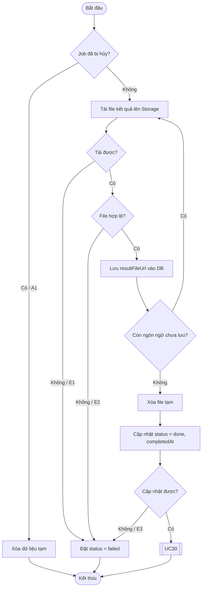

---

## UC30 — Gửi thông báo hoàn tất cho User

### Use Case Diagram

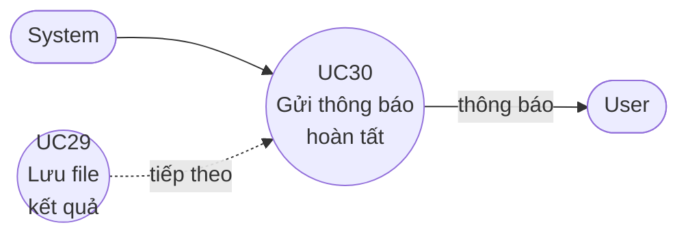

| Field | Content |
|---|---|
| **Use Case Number** | UC30 |
| **Use Case Name** | Gửi thông báo hoàn tất cho User |
| **Actor(s)** | *System* |
| **Maturity** | Focused |
| **Summary** | *System* thông báo cho *User* khi job xử lý xong (hoặc thất bại) qua thông báo trong ứng dụng và email, kèm đường dẫn để xem hoặc tải kết quả. |

### Basic Course of Events

| Actor Action | System Response |
|---|---|
| 1. Use case bắt đầu khi job chuyển sang `done` (UC29) hoặc `failed`. | |
| | 2. Hệ thống lấy thông tin chủ job (`userId`, `email`, `preferredLanguage`). **E1** |
| | 3. Hệ thống tạo nội dung thông báo theo `preferredLanguage` của User: tên file, trạng thái, danh sách ngôn ngữ đích và liên kết tới trang chi tiết job. **A1** |
| | 4. Hệ thống gửi thông báo trong ứng dụng (Web/Mobile) cho User. **E2** |
| | 5. Hệ thống gửi email thông báo tới địa chỉ email của User. **E3** |
| | 6. Hệ thống ghi nhận đã gửi thông báo.   *Use case kết thúc.* |

### Alternative Paths

**A1.** Nếu job có `status = failed`, nội dung thông báo nêu job thất bại, lý do ngắn gọn và gợi ý User gửi lại hoặc báo lỗi (UC18). Tiếp tục bước 4.

### Exception Paths

**E1.** Nếu không tìm thấy User của job (tài khoản đã bị xóa), hệ thống bỏ qua việc gửi thông báo và ghi log. Use case kết thúc.

**E2.** Nếu không gửi được thông báo trong ứng dụng, hệ thống ghi log và vẫn tiếp tục gửi email (bước 5). Kết quả job không bị ảnh hưởng.

**E3.** Nếu không gửi được email (lỗi dịch vụ email), hệ thống thử lại theo BR-30.3; nếu vẫn lỗi, hệ thống ghi log. Kết quả job không bị ảnh hưởng, User vẫn xem được kết quả trong lịch sử (UC15). Use case kết thúc.

### Other Fields

| Field | Content |
|---|---|
| **Extension Points** | None |
| **Triggers** | Job chuyển sang trạng thái `done` hoặc `failed`. |
| **Assumptions** | Dịch vụ email và kênh thông báo trong ứng dụng đang hoạt động. |
| **Preconditions** | Job đã ở trạng thái `done` hoặc `failed`; User của job tồn tại. |
| **Post Conditions** | User đã được thông báo về kết quả job. Thất bại khi gửi thông báo không làm đổi `status` của job. |
| **Reference: Business Rules** | BR-30.1: Thông báo chỉ gửi cho chủ job.  BR-30.2: Nội dung thông báo dùng `preferredLanguage` của User.  BR-30.3: Gửi email lỗi được thử lại tối đa 3 lần.  BR-30.4: Thông báo không chứa mật khẩu hoặc `token`, chỉ chứa liên kết tới trang chi tiết job. |
| **Author(s)** | Nhóm Đồ án |
| **Date** | 28-09-26 |

### Activity Diagram

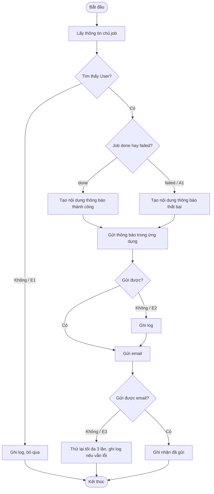
