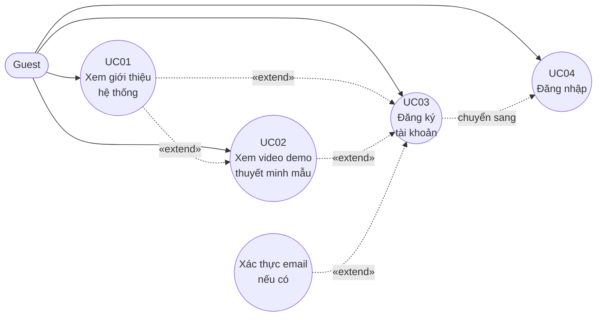
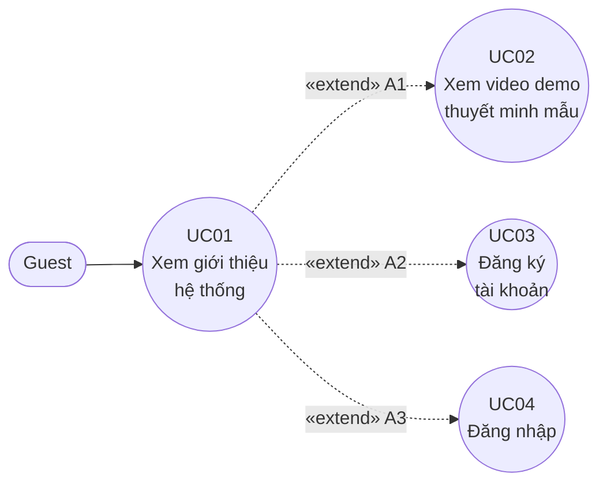
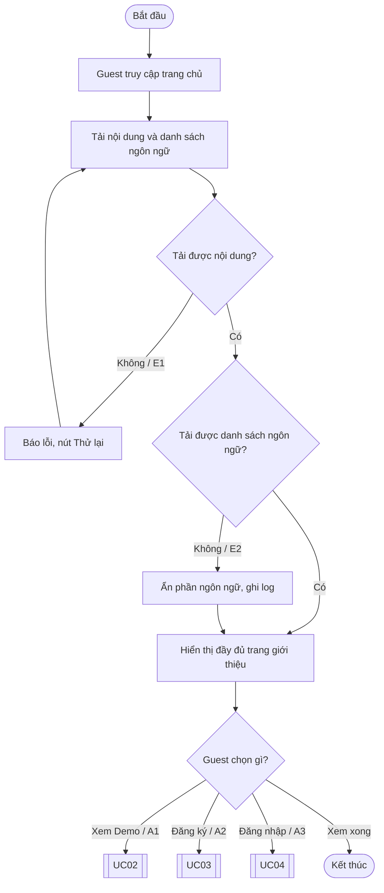
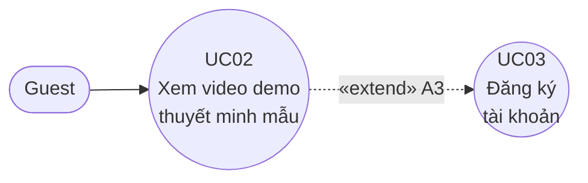
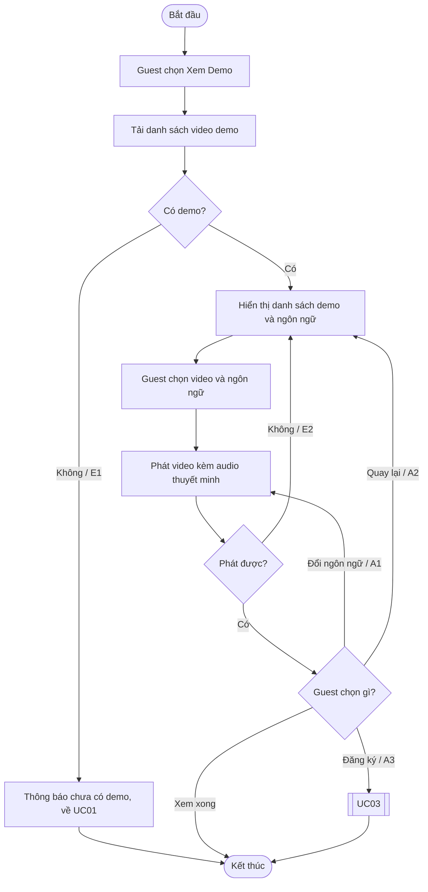
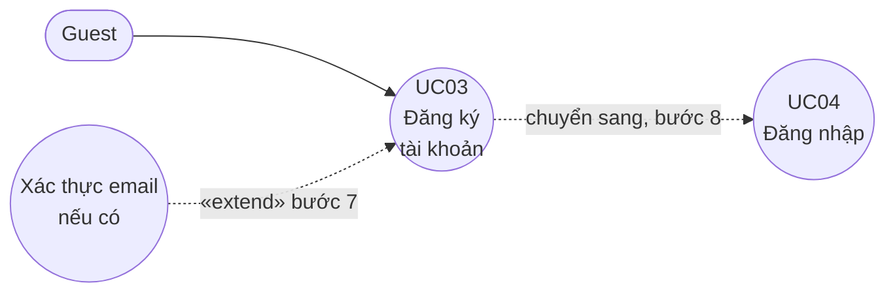
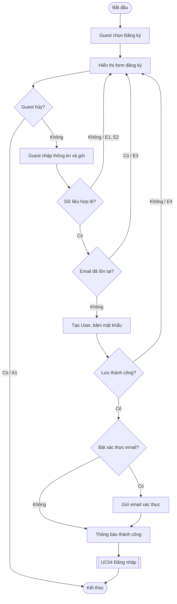
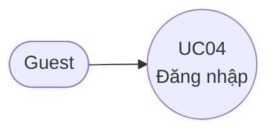
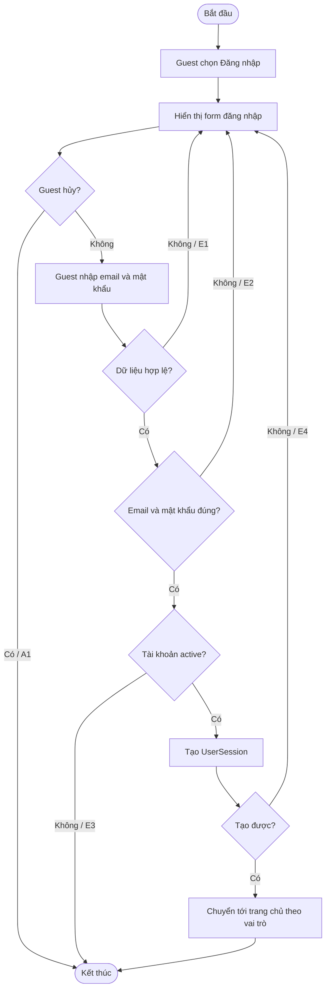

# Thuyết minh tự động đa ngôn ngữ — Focused Use Cases (Actor: Guest)

**Version 1.2**

> Theo mẫu `FocusedUseCases.md` (Course Cast) và danh sách Use Case trong PRD (mục 6, Actor: Guest). Nhãn trường giữ tiếng Anh như mẫu, nội dung tiếng Việt.

## Revision History

| Date     | Version | Description                                                                      | Author     |
|----------|---------|----------------------------------------------------------------------------------|------------|
| 28-09-26 | 1.0     | Bản nháp đầu (2 UC)                                                              | Nhóm Đồ án |
| 28-09-26 | 1.1     | Làm lại theo PRD: UC01–UC04, Use Case Diagram, Activity Diagrams (Guest)         | Nhóm Đồ án |
| 28-09-26 | 1.2     | Thêm Use Case Diagram riêng cho từng UC                                          | Nhóm Đồ án |

## Table of Contents

| Mã   | Use Case                            |
|------|-------------------------------------|
| [UC01](#uc01--xem-trang-giới-thiệu-hệ-thống) | Xem trang giới thiệu hệ thống |
| [UC02](#uc02--xem-video-demo-thuyết-minh-mẫu) | Xem video demo thuyết minh mẫu |
| [UC03](#uc03--đăng-ký-tài-khoản) | Đăng ký tài khoản |
| [UC04](#uc04--đăng-nhập) | Đăng nhập |

## Use Case Diagram tổng quan (Guest)

---

## UC01 — Xem trang giới thiệu hệ thống

### Use Case Diagram

| Field | Content |
|---|---|
| **Use Case Number** | UC01 |
| **Use Case Name** | Xem trang giới thiệu hệ thống |
| **Actor(s)** | *Guest* |
| **Maturity** | Focused |
| **Summary** | *Guest* (chưa đăng nhập) xem trang giới thiệu để hiểu hệ thống làm được gì, quy trình xử lý ra sao và hỗ trợ những *ngôn ngữ* nào trước khi quyết định đăng ký. |

### Basic Course of Events

| Actor Action | System Response |
|---|---|
| 1. Use case bắt đầu khi Guest truy cập trang chủ của hệ thống (Web hoặc Mobile). | |
| | 2. Hệ thống tải nội dung giới thiệu và danh sách *ngôn ngữ* đang được hỗ trợ. **E1, E2** |
| | 3. Hệ thống hiển thị trang giới thiệu gồm: mô tả hệ thống, các tính năng chính, quy trình xử lý (upload → Speech-to-Text → dịch → Text-to-Speech → ghép vào video gốc), danh sách ngôn ngữ hỗ trợ, và các lựa chọn "Xem Demo", "Đăng ký", "Đăng nhập". |
| 4. Guest xem nội dung trang giới thiệu. **A1, A2, A3**   *Use case kết thúc.* | |

### Alternative Paths

**A1.** Guest chọn "Xem Demo". Thực hiện **{Xem video demo thuyết minh mẫu}** (UC02).

**A2.** Guest chọn "Đăng ký". Thực hiện **{Đăng ký tài khoản}** (UC03).

**A3.** Guest chọn "Đăng nhập". Thực hiện **{Đăng nhập}** (UC04).

### Exception Paths

**E1.** Nếu không tải được nội dung giới thiệu (lỗi máy chủ hoặc mất kết nối), hệ thống hiển thị thông báo lỗi kèm nút "Thử lại". Quay lại bước 2.

**E2.** Nếu chỉ không tải được danh sách ngôn ngữ, hệ thống vẫn hiển thị trang giới thiệu, ẩn phần danh sách ngôn ngữ và ghi nhận lỗi. Tiếp tục bước 3.

### Other Fields

| Field | Content |
|---|---|
| **Extension Points** | **{Xem video demo thuyết minh mẫu}** (A1), **{Đăng ký tài khoản}** (A2), **{Đăng nhập}** (A3) |
| **Triggers** | Guest truy cập hệ thống lần đầu hoặc muốn tìm hiểu thêm về hệ thống. |
| **Assumptions** | Nội dung giới thiệu là nội dung công khai do đội phát triển cung cấp. |
| **Preconditions** | Không yêu cầu đăng nhập. |
| **Post Conditions** | Guest đã xem trang giới thiệu; không có dữ liệu người dùng nào được lưu. |
| **Reference: Business Rules** | BR-1.1: Trang giới thiệu là nội dung công khai, không yêu cầu tài khoản.  BR-1.2: Chỉ hiển thị các ngôn ngữ có `isSupported = true`. |
| **Author(s)** | Nhóm Đồ án |
| **Date** | 28-09-26 |

### Activity Diagram

---

## UC02 — Xem video demo thuyết minh mẫu

### Use Case Diagram

| Field | Content |
|---|---|
| **Use Case Number** | UC02 |
| **Use Case Name** | Xem video demo thuyết minh mẫu |
| **Actor(s)** | *Guest* |
| **Maturity** | Focused |
| **Summary** | *Guest* xem thử các video demo đã có thuyết minh sẵn bằng nhiều *ngôn ngữ* để đánh giá chất lượng kết quả của hệ thống mà không cần tài khoản và không thể upload hay xử lý video. |

### Basic Course of Events

| Actor Action | System Response |
|---|---|
| 1. Use case bắt đầu khi Guest chọn "Xem Demo" (từ trang giới thiệu hoặc từ menu). | |
| | 2. Hệ thống tải và hiển thị danh sách video demo, mỗi video kèm các ngôn ngữ thuyết minh có sẵn. **E1** |
| 3. Guest chọn một video demo và một ngôn ngữ thuyết minh. | |
| | 4. Hệ thống phát video demo kèm audio thuyết minh theo ngôn ngữ đã chọn. **E2** |
| 5. Guest xem demo. **A1, A2, A3**   *Use case kết thúc.* | |

### Alternative Paths

**A1.** Trong lúc xem, Guest đổi sang ngôn ngữ thuyết minh khác. Hệ thống phát video với ngôn ngữ mới. Quay lại bước 4 của Basic Course of Events.

**A2.** Guest chọn "Quay lại" để trở về danh sách demo. Quay lại bước 2 của Basic Course of Events.

**A3.** Guest chọn "Đăng ký". Thực hiện **{Đăng ký tài khoản}** (UC03).

### Exception Paths

**E1.** Nếu chưa có video demo nào hoặc không tải được danh sách, hệ thống hiển thị thông báo "Hiện chưa có bản demo" và đưa Guest về trang giới thiệu (UC01).

**E2.** Nếu không phát được video hoặc audio của ngôn ngữ đã chọn (tệp lỗi hoặc mất kết nối), hệ thống hiển thị thông báo lỗi và cho Guest chọn lại video hoặc ngôn ngữ. Quay lại bước 2.

### Other Fields

| Field | Content |
|---|---|
| **Extension Points** | **{Đăng ký tài khoản}** (A3) |
| **Triggers** | Guest muốn trải nghiệm thử kết quả thuyết minh trước khi đăng ký. |
| **Assumptions** | Các video demo được chuẩn bị sẵn và lưu trong storage; Guest không kích hoạt AI pipeline. |
| **Preconditions** | Không yêu cầu đăng nhập. |
| **Post Conditions** | Guest đã xem video demo; không tạo `TranscriptionJob` nào và không có dữ liệu người dùng nào được lưu. |
| **Reference: Business Rules** | BR-2.1: Guest chỉ được xem demo, không được upload hay tạo job (theo PRD, mục 2).  BR-2.2: Chỉ cung cấp ngôn ngữ thuyết minh đã có sẵn cho từng video demo. |
| **Author(s)** | Nhóm Đồ án |
| **Date** | 28-09-26 |

### Activity Diagram

---

## UC03 — Đăng ký tài khoản

### Use Case Diagram

| Field | Content |
|---|---|
| **Use Case Number** | UC03 |
| **Use Case Name** | Đăng ký tài khoản |
| **Actor(s)** | *Guest* |
| **Maturity** | Focused |
| **Summary** | *Guest* tạo tài khoản mới để trở thành *User*, từ đó có thể upload video/audio, gửi yêu cầu thuyết minh và lưu lịch sử xử lý. |

### Basic Course of Events

| Actor Action | System Response |
|---|---|
| 1. Use case bắt đầu khi Guest chọn "Đăng ký". **A1** | |
| | 2. Hệ thống hiển thị form đăng ký gồm: họ tên (`fullName`), email, mật khẩu, xác nhận mật khẩu. |
| 3. Guest nhập thông tin và chọn "Đăng ký". **A1** | |
| | 4. Hệ thống kiểm tra dữ liệu nhập vào. **{Validate Registration Data}** **E1, E2** |
| | 5. Hệ thống kiểm tra email chưa tồn tại trong hệ thống. **E3** |
| | 6. Hệ thống tạo bản ghi *User* mới với `role = user`, `status = active`, mật khẩu được băm trước khi lưu. **E4** |
| | 7. *(Nếu hệ thống bật xác thực email)* Hệ thống gửi email xác thực cho Guest. **{Xác thực email}** |
| | 8. Hệ thống thông báo đăng ký thành công và chuyển Guest sang màn hình đăng nhập. **{Đăng nhập}**   *Use case kết thúc.* |

### Alternative Paths

**A1.** Guest chọn "Hủy" hoặc "Quay lại" khi đang ở form đăng ký. Hệ thống bỏ dữ liệu đã nhập và đưa Guest về trang chủ. Use case kết thúc.

### Exception Paths

**E1.** Tại **{Validate Registration Data}**, nếu có trường bắt buộc bị bỏ trống hoặc email sai định dạng, hệ thống đánh dấu trường lỗi và nêu rõ lý do. Quay lại bước 2, giữ nguyên dữ liệu hợp lệ đã nhập.

**E2.** Tại **{Validate Registration Data}**, nếu mật khẩu không đạt yêu cầu (BR-3.2) hoặc xác nhận mật khẩu không khớp, hệ thống thông báo lỗi. Quay lại bước 2.

**E3.** Nếu email đã tồn tại, hệ thống thông báo email đã được sử dụng và gợi ý đăng nhập. Quay lại bước 2.

**E4.** Nếu hệ thống không lưu được tài khoản (lỗi cơ sở dữ liệu), hệ thống thông báo lỗi, không tạo tài khoản nào và cho Guest thử lại. Quay lại bước 2.

### Other Fields

| Field | Content |
|---|---|
| **Extension Points** | **{Validate Registration Data}** — Kiểm tra trường bắt buộc, định dạng email, độ mạnh mật khẩu, khớp xác nhận mật khẩu. (Xem BR-3.1, BR-3.2) **E1, E2**   **{Xác thực email}** — Bước tùy chọn theo PRD ("Xác thực email (nếu có)"): người dùng xác nhận email qua liên kết được gửi. |
| **Triggers** | Guest muốn sử dụng các chức năng dành cho người dùng đã đăng ký. |
| **Assumptions** | Guest có địa chỉ email hợp lệ và chưa có tài khoản. |
| **Preconditions** | Guest chưa đăng nhập. |
| **Post Conditions** | Một bản ghi *User* mới (`role = user`, `status = active`) được lưu vào hệ thống; Guest có thể đăng nhập bằng tài khoản này. |
| **Reference: Business Rules** | BR-3.1: Email phải đúng định dạng và là duy nhất trong hệ thống.  BR-3.2: Mật khẩu tối thiểu 8 ký tự, gồm cả chữ và số.  BR-3.3: Mật khẩu chỉ được lưu dưới dạng băm (`password (hashed)`).  BR-3.4: Tài khoản mới có vai trò mặc định là User. |
| **Author(s)** | Nhóm Đồ án |
| **Date** | 28-09-26 |

### Activity Diagram

---

## UC04 — Đăng nhập

### Use Case Diagram

| Field | Content |
|---|---|
| **Use Case Number** | UC04 |
| **Use Case Name** | Đăng nhập (Login Authentication) |
| **Actor(s)** | *Guest* |
| **Maturity** | Focused |
| **Summary** | *Guest* đã có tài khoản đăng nhập bằng email và mật khẩu để bắt đầu một *phiên làm việc* (`UserSession`) và sử dụng các chức năng theo vai trò của mình. |

### Basic Course of Events

| Actor Action | System Response |
|---|---|
| 1. Use case bắt đầu khi Guest chọn "Đăng nhập". | |
| | 2. Hệ thống hiển thị form đăng nhập gồm: email, mật khẩu. |
| 3. Guest nhập email và mật khẩu, chọn "Đăng nhập". **A1** | |
| | 4. Hệ thống kiểm tra dữ liệu nhập vào. **E1** |
| | 5. Hệ thống tìm tài khoản theo email và so khớp mật khẩu đã băm. **E2** |
| | 6. Hệ thống kiểm tra trạng thái tài khoản phải là `active`. **E3** |
| | 7. Hệ thống tạo *UserSession* (thiết bị `web`, `ios` hoặc `android`, `token`, `expiresAt`). **E4** |
| | 8. Hệ thống chuyển người dùng tới trang chủ theo vai trò của tài khoản (User: trang chủ người dùng; Admin: trang quản trị).   *Use case kết thúc.* |

### Alternative Paths

**A1.** Guest chọn "Hủy" hoặc "Quay lại" khi đang ở form đăng nhập. Hệ thống đưa Guest về trang chủ. Use case kết thúc.

### Exception Paths

**E1.** Nếu email hoặc mật khẩu bỏ trống, hoặc email sai định dạng, hệ thống đánh dấu trường lỗi. Quay lại bước 2.

**E2.** Nếu không tìm thấy email hoặc mật khẩu không khớp, hệ thống hiển thị thông báo chung "Email hoặc mật khẩu không đúng" (không tiết lộ trường nào sai). Quay lại bước 2.

**E3.** Nếu tài khoản có `status = inactive` hoặc `banned`, hệ thống từ chối đăng nhập và thông báo tài khoản không thể sử dụng. Use case kết thúc.

**E4.** Nếu không tạo được phiên làm việc (lỗi hệ thống), hệ thống thông báo lỗi và cho thử lại. Quay lại bước 2.

### Other Fields

| Field | Content |
|---|---|
| **Extension Points** | None |
| **Triggers** | 1. Guest đã có tài khoản và muốn sử dụng chức năng của User.  2. Phiên làm việc đã hết hạn (`expiresAt`) hoặc đã đăng xuất.  3. Guest vừa đăng ký xong (UC03). |
| **Assumptions** | Guest đã có tài khoản hợp lệ. |
| **Preconditions** | Guest chưa có phiên làm việc đang hoạt động. |
| **Post Conditions** | Một *UserSession* đang hoạt động được tạo cho tài khoản; người dùng có các chức năng phù hợp với vai trò. |
| **Reference: Business Rules** | BR-4.1: Chỉ tài khoản `status = active` mới được đăng nhập.  BR-4.2: Thông báo lỗi đăng nhập không được tiết lộ email có tồn tại hay không.  BR-4.3: Phiên làm việc có thời hạn `expiresAt`; hết hạn thì phải đăng nhập lại.  BR-4.4: Chức năng khả dụng phụ thuộc `role` (user / premium / admin). |
| **Author(s)** | Nhóm Đồ án |
| **Date** | 28-09-26 |

### Activity Diagram

