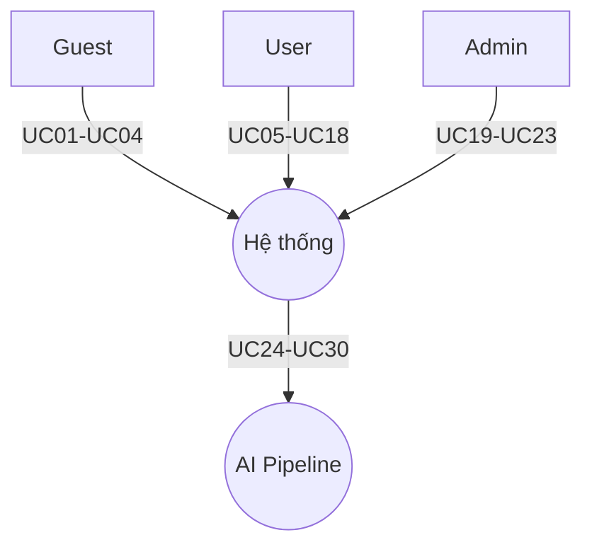
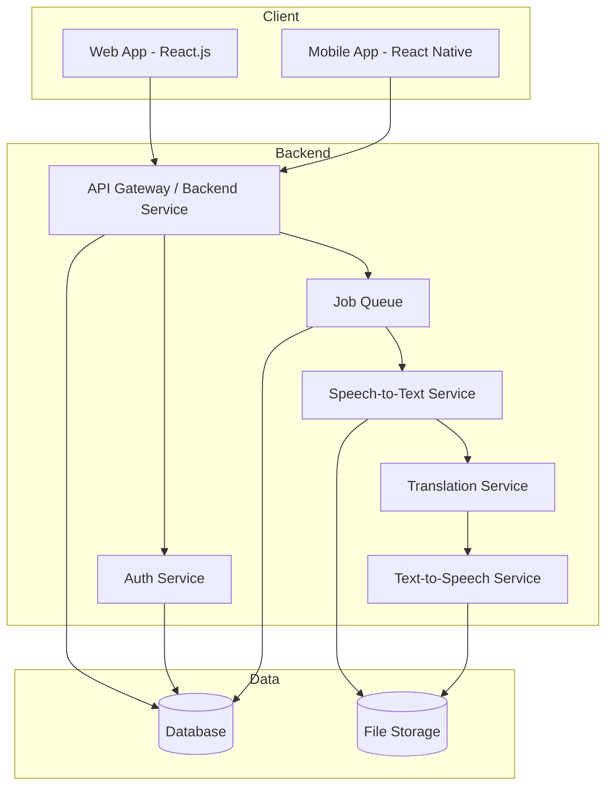
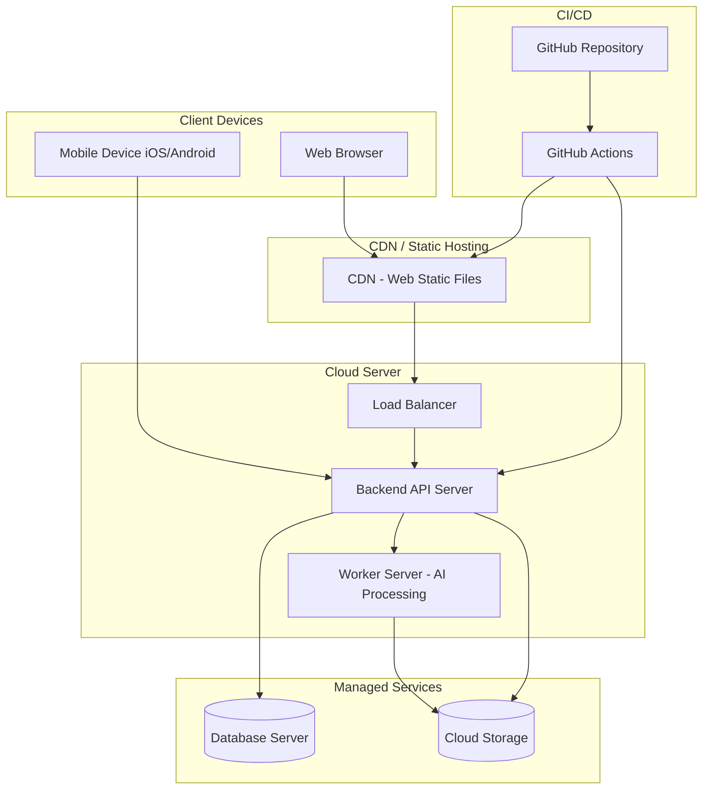
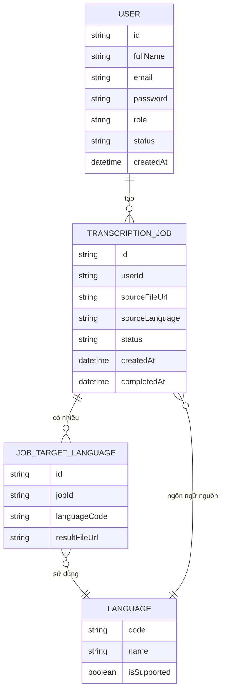
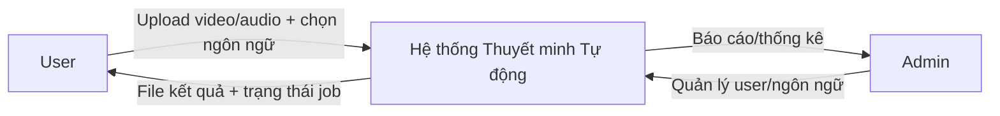
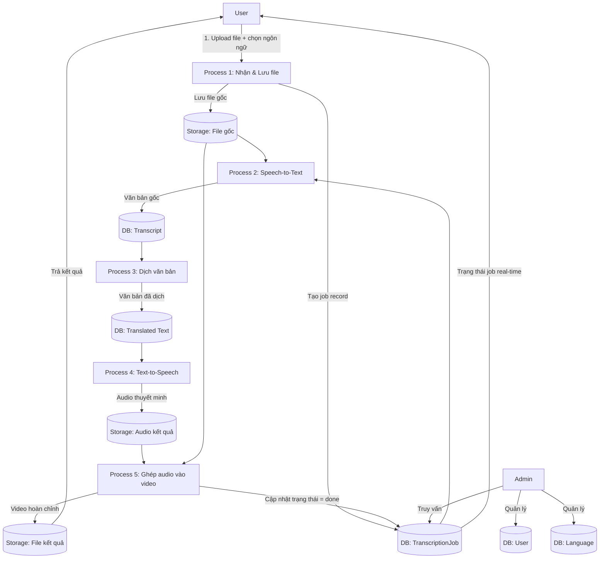

# PRD — Hệ thống Thuyết minh Tự động Đa ngôn ngữ

> **Đề tài:** Thuyết minh tự động đa ngôn ngữ\
> **Loại tài liệu:** Product Requirements Document (PRD)\
> **Phạm vi:** Web (React.js) + Mobile (React Native)

---

## 1. Giới thiệu

Hệ thống cho phép người dùng upload video/audio, tự động chuyển giọng nói thành văn bản, dịch sang một hoặc nhiều ngôn ngữ đích, sau đó chuyển văn bản đã dịch thành giọng nói (thuyết minh) và ghép vào video gốc.

---

## 2. Vai trò người dùng (User Roles)

| Vai trò | Quyền hạn chính |
|---|---|
| **Guest** (Khách) | Xem giới thiệu, xem demo, không upload/xử lý được video |
| **User** (Người dùng đăng ký) | Upload video/audio, chọn ngôn ngữ nguồn & đích, xem lịch sử xử lý, tải kết quả |
| **Premium User** *(tùy chọn mở rộng)* | Giới hạn thời lượng/số lượng cao hơn, chất lượng giọng đọc AI tốt hơn |
| **Admin** | Quản lý user, theo dõi job xử lý, quản lý ngôn ngữ hỗ trợ, xem log hệ thống |

---

## 3. User Stories

| Vai trò | User Story |
|---|---|
| Guest | Xem trang giới thiệu & demo trước khi đăng ký |
| User | Đăng ký/đăng nhập để lưu lịch sử xử lý |
| User | Upload video/audio để tạo thuyết minh tự động |
| User | Chọn ngôn ngữ nguồn và một/nhiều ngôn ngữ đích |
| User | Theo dõi trạng thái xử lý (pending/processing/done/failed) |
| User | Tải xuống file kết quả sau khi xử lý xong |
| User | Xem lại lịch sử các job đã thực hiện |
| Admin | Quản lý danh sách user & trạng thái tài khoản |
| Admin | Theo dõi các job xử lý để phát hiện lỗi hệ thống |
| Admin | Quản lý danh sách ngôn ngữ được hỗ trợ |

---

## 4. Luồng người dùng (User Flow)

```text
Guest
  │
  ├── Xem trang chủ / Demo
  ├── Đăng ký (Register)
  │      ↓
  │   Xác thực email (nếu có)
  │      ↓
  │   Đăng nhập (Login)
  │      ↓
User (đã đăng nhập)
  │
  ├── Upload Video/Audio
  │      ↓
  ├── Chọn ngôn ngữ nguồn (source language)
  ├── Chọn ngôn ngữ đích (target language) — có thể chọn nhiều
  │      ↓
  ├── Hệ thống xử lý:
  │      Speech-to-Text → Dịch văn bản → Text-to-Speech
  │      ↓
  ├── Xem/Preview kết quả thuyết minh
  ├── Tải xuống / Xuất video có thuyết minh
  │      ↓
  └── Lưu vào "Lịch sử xử lý" (History)
```

---

## 5. Cấu trúc dữ liệu User (Schema)

```text
User
├── id
├── fullName
├── email
├── password (hashed)
├── avatarUrl
├── role            // guest | user | premium | admin
├── preferredLanguage   // ngôn ngữ UI mặc định
├── createdAt
├── updatedAt
└── status          // active | inactive | banned

UserSession (Mobile/Web)
├── id
├── userId (FK → User)
├── device           // web | ios | android
├── token
└── expiresAt

TranscriptionJob (liên kết với User)
├── id
├── userId (FK → User)
├── sourceFileUrl
├── sourceLanguage
├── targetLanguages[]   // danh sách ngôn ngữ đích
├── status           // pending | processing | done | failed
├── resultFileUrl
├── createdAt
└── completedAt
```

---

## 6. Danh sách Use Case

### Actor: Guest
| Mã | Use Case |
|---|---|
| UC01 | Xem trang giới thiệu hệ thống |
| UC02 | Xem video demo thuyết minh mẫu |
| UC03 | Đăng ký tài khoản |
| UC04 | Đăng nhập |

### Actor: User
| Mã | Use Case |
|---|---|
| UC05 | Đăng xuất |
| UC06 | Cập nhật thông tin cá nhân (Profile) |
| UC07 | Đổi mật khẩu |
| UC08 | Upload video/audio |
| UC09 | Chọn ngôn ngữ nguồn (source language) |
| UC10 | Chọn một hoặc nhiều ngôn ngữ đích (target languages) |
| UC11 | Gửi yêu cầu xử lý thuyết minh (Submit Job) |
| UC12 | Theo dõi trạng thái xử lý job (real-time/polling) |
| UC13 | Xem/preview kết quả thuyết minh (audio/video output) |
| UC14 | Tải xuống file kết quả |
| UC15 | Xem lịch sử các job đã xử lý |
| UC16 | Xóa job / xóa file khỏi lịch sử |
| UC17 | Hủy job đang xử lý |
| UC18 | Báo lỗi kết quả xử lý (feedback/report) |

### Actor: Admin
| Mã | Use Case |
|---|---|
| UC19 | Quản lý danh sách người dùng (khóa/mở tài khoản) |
| UC20 | Xem thống kê số lượng job xử lý |
| UC21 | Theo dõi job lỗi (failed jobs) và log hệ thống |
| UC22 | Quản lý danh sách ngôn ngữ hỗ trợ (thêm/xóa/sửa) |
| UC23 | Xem báo cáo hiệu suất hệ thống (thời gian xử lý trung bình...) |

### Actor: System (AI Pipeline nội bộ)
| Mã | Use Case |
|---|---|
| UC24 | Trích xuất audio từ video upload |
| UC25 | Chuyển giọng nói thành văn bản (Speech-to-Text) |
| UC26 | Dịch văn bản sang ngôn ngữ đích (Machine Translation) |
| UC27 | Chuyển văn bản thành giọng nói (Text-to-Speech) |
| UC28 | Ghép audio thuyết minh vào video gốc |
| UC29 | Lưu file kết quả vào storage |
| UC30 | Gửi thông báo hoàn tất cho User (notification/email) |

### Sơ đồ Use Case tổng quan



---

## 7. Lược đồ Component (Component Diagram)



---

## 8. Lược đồ Deploy (Deployment Diagram)



---

## 9. Lược đồ Mô hình Thực thể Kết hợp (ERD)



---

## 10. Luồng dữ liệu (Data Flow)

### 10.1 DFD Level 0 (Context Diagram)



### 10.2 DFD Level 1 (Chi tiết xử lý)



### 10.3 Luồng xử lý chi tiết theo từng bước (1 Job)

```text
[1] User upload video/audio
      ↓ lưu vào Storage, tạo record TranscriptionJob (status: pending)
[2] Worker lấy job từ Queue
      ↓ status → processing
[3] Trích xuất audio từ video (nếu input là video)
      ↓
[4] Speech-to-Text: audio gốc → văn bản (theo sourceLanguage)
      ↓ lưu transcript vào DB
[5] Translation: văn bản gốc → văn bản theo từng targetLanguage
      ↓ lưu bản dịch vào DB (bảng JOB_TARGET_LANGUAGE)
[6] Text-to-Speech: văn bản dịch → audio thuyết minh (theo từng ngôn ngữ)
      ↓ lưu file audio vào Storage
[7] Ghép audio thuyết minh vào video gốc (nếu cần xuất video)
      ↓ lưu resultFileUrl vào DB
[8] Cập nhật status → done (hoặc failed nếu lỗi ở bất kỳ bước nào)
      ↓
[9] Gửi notification cho User + cho phép tải kết quả
```

---

## 11. Màn hình liên quan (Screen Mapping)

- **Web:** Trang Đăng nhập/Đăng ký, Trang Profile, Trang Upload & Chọn ngôn ngữ, Trang Lịch sử xử lý
- **Mobile:** Login/Register Screen, Home Screen, Upload Screen, History Screen, Profile Screen
