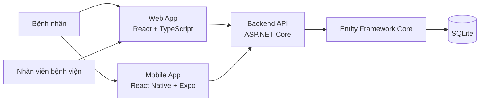

```
# Multilingual Automatic Narration System

<p align="center">
  <strong>Hospital Visit Guidance · Web & Mobile</strong><br>
  Đồ án môn Công nghệ phần mềm · Sai Gon University · Nhóm 01
</p>

<p align="center">
  
  
  
  
  
</p>

---

## 1. Giới thiệu

**Multilingual Automatic Narration System** là đồ án xây dựng trải nghiệm hướng dẫn người dùng trong quy trình thăm khám tại bệnh viện. Hệ thống hướng đến việc giúp bệnh nhân theo dõi hành trình khám, nhận hướng dẫn theo từng bước và tiếp cận nội dung hướng dẫn đa ngôn ngữ đã được duyệt. Nhân viên bệnh viện thao tác trên giao diện phù hợp với vai trò của mình.

Repository chứa mã nguồn Web/Mobile, API, sơ đồ phân tích nghiệp vụ và tài liệu phục vụ phát triển, kiểm thử, trình diễn đồ án.

## 2. Mục tiêu

- Xây dựng ứng dụng Web và Mobile có trải nghiệm nhất quán.
- Hỗ trợ quy trình bệnh nhân từ tiếp nhận đến theo dõi các bước trong lượt khám.
- Hỗ trợ mã QR/mã lượt để truy cập đúng hành trình hướng dẫn.
- Tổ chức nội dung hướng dẫn và lời dặn theo quy trình phê duyệt.
- Áp dụng quy trình cộng tác nhóm bằng Git/GitHub: Issues, branches, Pull Requests và code review.
- Từng bước hoàn thiện kiểm thử và CI/CD theo phạm vi đồ án.

## 3. Chức năng chính

| Nhóm chức năng | Nội dung |
| --- | --- |
| Bệnh nhân | Truy cập hướng dẫn, theo dõi hành trình khám, xem nội dung đã công bố và lịch sử liên quan |
| Tiếp nhận | Xử lý yêu cầu đến khám, tra cứu/xác minh thông tin và cấp mã/phiếu theo quy trình |
| Bác sĩ | Quản lý lượt khám, ghi nhận nội dung tư vấn, chẩn đoán và hướng dẫn theo quy trình |
| Nhân viên dịch vụ | Cập nhật tiến độ dịch vụ hỗ trợ trong hành trình khám |
| Thu ngân | Ghi nhận trạng thái thanh toán theo luồng nghiệp vụ |
| Quản trị | Cấu hình nội dung và quy trình hướng dẫn của bệnh viện |
| Hướng dẫn đa ngôn ngữ | Trình bày nội dung và phát lời hướng dẫn theo phạm vi được cấu hình, phê duyệt |

> Chi tiết luồng nghiệp vụ và cách chạy demo được mô tả trong [hướng dẫn mã nguồn](codes/README.md). Các chức năng đang phát triển có thể thay đổi theo tiến độ đồ án.

## 4. Công nghệ

| Thành phần | Công nghệ |
| --- | --- |
| Web frontend | React.js, TypeScript |
| Mobile app | React Native, Expo |
| Backend API | ASP.NET Core 9 |
| Data access | Entity Framework Core |
| Cơ sở dữ liệu demo | SQLite |
| Quản lý phiên bản | Git, GitHub |
| Tự động hóa | CI/CD theo kế hoạch phát triển |

## 5. Kiến trúc tổng quan



## 6. Cấu trúc repository

```text
.
├── .github/                    # Mẫu Issue và Pull Request
├── UC_activity_diagram/        # Sơ đồ hoạt động nghiệp vụ
├── codes/
│   ├── apps/
│   │   ├── web/                # Ứng dụng Web
│   │   └── mobile/             # Ứng dụng Mobile
│   ├── services/api/           # Backend API
│   ├── scripts/                # Script hỗ trợ chạy demo
│   ├── instruction/            # Đặc tả và tài liệu yêu cầu
│   └── README.md               # Hướng dẫn setup/chạy chi tiết
├── docs/                       # Tài liệu dự án
├── Ke_hoach_nhom.docx          # Kế hoạch làm việc nhóm
├── todo.md                     # Checklist và tiến độ 12 tuần
├── CONTRIBUTING.md             # Quy ước đóng góp
└── README.md                   # Trang giới thiệu dự án
```

## 7. Bắt đầu chạy demo

### Yêu cầu môi trường

- .NET SDK 9
- Node.js 22.19
- Python 3.13

### Khởi động trên Windows PowerShell

Tại thư mục gốc của repository:

```powershell
cd codes
dotnet restore services/api --locked-mode
npm.cmd ci --prefix apps/web
./scripts/start-demo.ps1
```

Khi script báo sẵn sàng, mở:

- Web: [http://127.0.0.1:5173](http://127.0.0.1:5173)
- API health check: [http://127.0.0.1:5047/health](http://127.0.0.1:5047/health)

Dừng demo trước khi build lại API:

```powershell
./scripts/stop-demo.ps1
```

**Lưu ý:** Đây là hướng dẫn chạy demo dành cho môi trường phát triển, không phải hướng dẫn triển khai production. Cách chạy Mobile, cấu hình môi trường và kịch bản demo chi tiết nằm trong [`codes/README.md`](codes/README.md). Không commit file `.env`, token, khóa ký hoặc thông tin xác thực thật lên repository.

## 8. Tài liệu và sơ đồ

### Tài liệu dự án

- [Hướng dẫn chạy ứng dụng, kịch bản demo và ghi chú kỹ thuật](codes/README.md)
- [Đặc tả/yêu cầu trong thư mục instruction](codes/instruction/)
- [Kế hoạch làm việc nhóm](Ke_hoach_nhom.docx)
- [Checklist và kế hoạch 12 tuần](todo.md)
- [Mục lục tài liệu](docs/README.md)

### Activity diagrams

Các sơ đồ hiện có được nhóm theo luồng nghiệp vụ để dễ tra cứu:

| # | Sơ đồ | Tệp |
| --- | --- | --- |
| 01 | Xác thực hoặc đăng ký bệnh nhân | [AD-01](UC_activity_diagram/AD-01-Authenticate-or-Register-Patient.png) |
| 02 | Tra cứu và xác nhận lịch hẹn | [AD-02](UC_activity_diagram/AD-02-Retrieve-and-Confirm-Existing-Appointment.png) |
| 03 | Chuẩn bị đăng ký khám trực tiếp | [AD-03](UC_activity_diagram/AD-03-Prepare-Walk-in-Registration.png) |
| 04 | Theo dõi hành trình bệnh nhân | [AD-04](UC_activity_diagram/AD-04-Follow-Patient-Journey.png) |
| 05 | Nghe hướng dẫn đã được duyệt | [AD-05](UC_activity_diagram/AD-05-Listen-to-Approved-Narration.png) |
| 06 | Điều hướng đến điểm cần đến | [AD-06](UC_activity_diagram/AD-06-Navigate-to-Destination.png) |
| 07 | Quản lý chỉ định của bác sĩ | [AD-07](UC_activity_diagram/AD-07-Manage-Doctor-Orders.png) |
| 08 | Gửi hướng dẫn có cấu trúc, đa ngôn ngữ | [AD-08](UC_activity_diagram/AD-08-Send-Structured-Multilingual-Instruction.png) |
| 09 | Yêu cầu hỗ trợ | [AD-09](UC_activity_diagram/AD-09-Request-Assistance.png) |
| 10 | Xem lịch sử khám | [AD-10](UC_activity_diagram/AD-10-View-Visit-History.png) |
| 11 | Quản lý khuyến nghị tái khám | [AD-11](UC_activity_diagram/AD-11-Manage-Follow-up-Recommendation.png) |
| 12 | Cấu hình quy trình và nội dung bệnh viện | [AD-12](UC_activity_diagram/AD-12-Configure-Hospital-Workflow-and-Content.png) |
| 13 | Vào hành trình bằng mã QR bệnh viện | [AD-13](UC_activity_diagram/AD-13-Enter-through-Hospital-QR.png) |
| 14 | Xác nhận tiếp nhận và cấp phiếu khám | [AD-14](UC_activity_diagram/AD-14-Confirm-Reception-and-Issue-Examination-Ticket.png) |
| 15 | Kích hoạt hoặc tiếp tục hành trình | [AD-15](UC_activity_diagram/AD-15-Activate-or-Resume-Patient-Journey.png) |
| 16 | Liên kết hồ sơ khách với tài khoản | [AD-16](UC_activity_diagram/AD-16-Link-Guest-Records-to-an-Account.png) |
| 17 | Ghi nhận tiến độ tư vấn và dịch vụ | [AD-17](UC_activity_diagram/AD-17-Record-Consultation-and-Service-Progress.png) |

## 9. Quy trình làm việc nhóm

1. Tạo **Issue** cho task, bug hoặc đề xuất.
2. Tạo branch từ `main` theo quy ước trong [CONTRIBUTING.md](CONTRIBUTING.md).
3. Commit với nội dung mô tả đúng thay đổi.
4. Mở Pull Request, liên kết Issue và tự kiểm tra checklist.
5. Thành viên khác review trước khi merge.

Không đẩy trực tiếp thay đổi tính năng lên `main`. Hãy cập nhật Issue và checklist khi task hoàn thành để lịch sử phát triển phản ánh đúng tiến độ thực tế.

## 10. Nhóm thực hiện

**Môn học:** Công nghệ phần mềm (Software Engineering)  
**Trường:** Sai Gon University, Ho Chi Minh City  
**Lớp:** DCT124C3 · **Nhóm:** 01  
**Giảng viên:** Nguyễn Quốc Huy

| Thành viên | Vai trò |
| --- | --- |
| Lê Nguyễn Anh Bảo | Thành viên dự án |
| Trần Tiến Phát | Thành viên dự án |
| Nguyễn Khải Hoàn Ca | Thành viên dự án |

---

<p align="center">
  <sub>Course project · Academic use · Group 01</sub>
</p>
